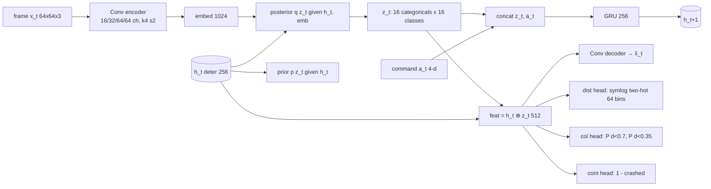

# Plan：参考 DreamerV3 重建世界模型（分支 `dreamerv3-world-model`）

> 目标：把现在的"单帧 → 四个固定视界的潜变量 → 碰撞头"（83k 参数，无记忆）换成
> DreamerV3 风格的 **RSSM 循环世界模型**：有记忆、可任意步数想象、带图像重建，
> 并在同一套三方对比（A 纯 pybullet / B 纯室内 / C 合并 × pybullet 柱子 / 室内续航）上
> 和现有模型正面比较。参考实现：<https://github.com/danijar/dreamerv3>
> （Hafner et al., *Mastering diverse control tasks through world models*, Nature 2025）。

---

## 1. 为什么要换：现有模型的三个结构性短板 ↔ DreamerV3 的对应机制

| 现状（`train_world_model.py`） | 造成的问题（报告里已测到） | DreamerV3 的对应部件 |
|---|---|---|
| 预测器只看**当前一帧** $z_t$，没有状态 | 柱子/家具一旦转出 60° 视野就被遗忘；室内续航 A/B/C 全部 16–17%，只能靠 `W_CENTER` 这种里程计先验凑合 | **RSSM** 的确定性状态 $h_t$（GRU）把看过的东西带着走，posterior/prior 两条路径 |
| 四个固定视界的残差头（+4/8/16/32），只能回答"保持这个命令 k 步" | 候选只能是单一命令，不能规划"先左偏 0.5 s 再直飞"；视界之外无法外推 | 一个**单步转移模型** $p(z_{t+1}\mid h_t, a_t)$，想象任意长度、任意动作序列 |
| 纯潜空间 MSE（JEPA），没有像素目标 | 潜变量是否真的编码了几何只能靠事后拟合解码器检查（4.4 节：室内 unseen 全部 gain ≤ 0） | **重建解码器** + 离散 32×C 类别潜变量 + KL balancing（dyn 1.0 / rep 0.1）+ free bits，固定超参跨域稳定 |
| 碰撞头直接二分类 0.7 m / 0.35 m | 概率地板随场景漂移，MPC 只能用"相对差"触发 | **symlog + two-hot** 回归**净空距离**本身，任意阈值的概率都从同一分布读出 |

一句话：DreamerV3 给我们的是 **记忆 + 可组合的想象 + 可视化的潜空间**，这正是室内测试里缺的三样。

---

## 2. 架构（"nano-Dreamer"）



| 模块 | 结构 | 参数量（估） | 对应 DreamerV3 |
|---|---|---|---|
| Encoder | Conv k4 s2 ×4：64²→32²→16²→8²→4²，通道 16/32/64/64，LayerNorm + SiLU | ≈ 0.11M | `enc.simple`（depth, mults） |
| RSSM | deter 256（LayerNorm-GRU），stoch 16×16 类别，hidden 128，unimix 1% | ≈ 0.6M | `dyn.rssm`（deter/stoch/classes/unimix） |
| Decoder | Linear 512→4×4×32，反卷积 ×4 → 64×64×3 | ≈ 0.3M | `dec.simple` |
| dist head | MLP 512→128→64 bins，symlog two-hot 回归净空 $d_t$ | ≈ 0.08M | `rewhead`（symexp_twohot，255 bins） |
| col / cont head | 共享 trunk 512→128，输出 2 + 1 logits | ≈ 0.07M | `conhead` |
| **合计** | | **≈ 1.1M ≈ 1.1 MB int8** | size1m 预设 ≈ 1M |

和 DreamerV3 官方预设的位置关系（来自 `dreamerv3/configs.yaml`）：

| 预设 | deter | hidden | classes | cnn depth | units |
|---|---|---|---|---|---|
| **本方案 nano** | 256 | 128 | 16 (×16 stoch) | 16 | 128 |
| size1m | 512 | 64 | 4 | 4 | 64 |
| size12m | 2048 | 256 | 16 | 16 | 256 |
| size200m（默认） | 8192 | 1024 | 64 | 64 | 1024 |

诚实说明：这是现有 83k 模型的 ~13 倍，超出课程的 512 KB int8 / GAP8 叙事；但我们的实际部署是
**笔记本 + Tello（SakanaDreamer）**，1M 参数的 GRU 一步在 CPU 上不到 1 ms，12 Hz 决策毫无压力。
如需更小，准备一个 `nano-S`（deter 128，stoch 8×8，depth 8，≈ 0.3M）作为回退配置。

---

## 3. 训练

### 3.1 数据：直接复用现有 npz，不改生成器

现有序列格式已经是 Dreamer 需要的样子（`frames (R,120,64,64,3)`, `actions (R,120,4)`, `dists`, `seg`, `cf_labels (R,120,6,4,2)`, `cf_visible`, 室内还有 `quat`、`scene_id`）：

| 训练集 | rollouts | 帧数 | 说明 |
|---|---|---|---|
| A `wm_dataset.npz` | 64 | 7,680 | pybullet 柱子，建议补生成到 256 rollouts（`gen_wm_dataset.py --rollouts 256`，几分钟） |
| B `wm_dataset_rooms_train60.npz` | 256 | 30,720 | ProcTHOR 房 0–15 |
| C `wm_dataset_pb_plus_rooms.npz` | 320 | 38,400 | 合并 |

- **时间尺度**：数据是 48 Hz，决策是 12 Hz。RSSM 按**决策步（12 Hz）**建模：每 4 帧取 1 帧，4 个相位偏移当作 4 倍数据增广；120 帧 → 30 步序列，命令段（约 1 s）仍然完整。这样想象 8 步 = 667 ms，正好对应现在的 +32。
- **切分**：沿用 `train_world_model._split_rollouts`（按 rollout 80/20，按 in_path × passive 分层），数字才可信。
- **序列采样**：batch 16 × length 24（DreamerV3 默认 16 × 64；我们的 rollout 只有 30 步），序列起点随机。
- **增广**：编码器输入沿用 `_augment`（Lesson 20 的外观增广），只在 `--robust` 时开；配合 `--randomize` 数据集解决外观过拟合（报告 4.3 已证明室内固定配色会把 AUC 打回 0.5）。

### 3.2 损失（逐项对照 DreamerV3）

$$\mathcal L = 1.0\,\mathcal L_{rec} + 1.0\,\mathcal L_{dist} + 1.0\,\mathcal L_{col} + 1.0\,\mathcal L_{cont} + 1.0\,\mathcal L_{dyn} + 0.1\,\mathcal L_{rep} + 1.0\,\mathcal L_{cf}$$

| 项 | 定义 | 来源 |
|---|---|---|
| $\mathcal L_{rec}$ | 解码器对 $x_t$ 的 MSE（像素 /255 − 0.5） | DreamerV3 `rec: 1.0` |
| $\mathcal L_{dist}$ | two-hot 交叉熵，目标 symlog($d_t$)，64 bins 覆盖 0–3.3 m | DreamerV3 reward head 的做法 |
| $\mathcal L_{col}$ | BCE：$[d_t<0.7]$、$[d_t<0.35]$ | 现有碰撞头（保留，便于和 A/B/C 同指标比较） |
| $\mathcal L_{cont}$ | BCE：$[d_t > 0.22]$（柱子）/ 未接触（房间） | DreamerV3 `con: 1.0` |
| $\mathcal L_{dyn}$ | $\max(1,\ \mathrm{KL}[\mathrm{sg}(q)\,\|\,p])$ | KL balancing，free nats 1.0 |
| $\mathcal L_{rep}$ | $\max(1,\ \mathrm{KL}[q\,\|\,\mathrm{sg}(p)])$ | `rep: 0.1` |
| $\mathcal L_{cf}$ | **反事实想象一致性**（本项目特有）：从 posterior 状态 $s_t$ 出发，对 6 个候选命令各用 prior 想象 1/2/4/8 步，col head 的输出对 `cf_labels[t, a, k, ring]` 做 BCE，`cf_visible` 作 mask | 把现有 oracle 监督搬进想象空间 |

DreamerV3 原样保留：类别潜变量 + straight-through 梯度、unimix 0.01、symlog/symexp、two-hot、LayerNorm + SiLU、KL balancing + free bits。
改动：没有 replay/在线交互（纯离线数据集）；reward 头换成 dist/col 头；新增 $\mathcal L_{cf}$。

### 3.3 优化

| 项 | 本方案 | DreamerV3 |
|---|---|---|
| 优化器 | Adam，lr 3e-4，eps 1e-8，warmup 1k 步，梯度裁剪 AGC 0.3（或 norm 100） | lr 4e-5，eps 1e-20，AGC 0.3，warmup 1000 |
| batch | 16 × 24 步 | 16 × 64 |
| 步数 | 30k–50k（5060 Ti 上估 20–40 min / 模型） | 按 train_ratio 持续 |
| 精度 | bf16 autocast | bfloat16 |
| 监控 | rec、KL(dyn/rep)、dist MAE、col AUC（posterior）、**open-loop**：观测 8 步后想象 22 步的解码帧 vs 真帧 gain、AUC@k（prior 想象） | |

**M2 的通过线**（否则先调模型再往下走）：held-out pybullet 上 open-loop AUC@32 ≥ 0.90（现 A = 0.93，但那是单帧 posterior；这里是纯想象），解码 gain@32 > 0.3（现 A 用事后拟合解码器约 0.4）。

---

## 4. 策略：两条路线，先 B1 后 B2

**B1 想象 MPC（无 RL，先做）** — `dreamer_policy.py: DreamerMPCPolicy`
- 每个决策步：encoder + posterior 更新 $(h_t, z_t)$（**状态跨决策保留**，这是和 `WMPolicy` 的本质区别）。
- 对每个候选（forward / slow / veer_left / veer_right / hover，+ 可选两段序列"veer 0.5 s → forward"）用 prior 想象 8 步，读 dist/col 头 → 期望最小净空、P(crit)。
- 触发和代价**完全沿用** `WMPolicy`（相对触发 `MARGIN_WM`、`cost = W_DANGER·danger + heading + W_CENTER·|y_after| − W_PROG·progress`、`EVADE_HOLD`），只换模型 → 对 A/B/C 的比较是 apples-to-apples。
- 室内额外测一组"菜单含 hover"：oracle 已证明同一菜单上限 32%，加悬停 89%（4.2 节），Dreamer 的记忆 + 悬停才有机会把室内数字拉上去。

**B2 梦中 actor-critic（DreamerV3 本体，视 B1 结果决定）** — `train_dreamer_actor.py`
- 想象长度 15，$\gamma = 0.95$（≈ 1.7 s @ 12 Hz），$\lambda = 0.95$，critic two-hot + EMA 慢目标，return 归一化（5–95 百分位），actor 熵 3e-4，6 个离散命令的类别策略 + unimix。
- 奖励：$r_t = 0.1\,v_x/v_{max} - 1.0\,[d_t<0.7] - 5.0\,[d_t<0.35]$，continue 用 cont 头。
- 风险：纯离线数据上的想象训练会"钻模型空子"。缓解：短视界、从真实 posterior 状态起步、保留 B1 作为安全回退并在报告里并列。

---

## 5. 评估：一个指标都不新加，全部复用

| 评测 | 脚本 | 需要的改动 |
|---|---|---|
| 离线网格（AUC@32、veer ranking、解码 gain，6 域） | `eval_offline.py` | `load_any()` 按 `meta["family"]` 分发；Dreamer 的 AUC@k 来自 prior 想象，解码 gain 用自带解码器（不再事后拟合） |
| pybullet 柱子 300 条 + 速度扫描 | `eval_world_model_policy.py`, `speed_sweep.py` | 策略工厂：`family == "dreamer"` → `DreamerMPCPolicy` |
| 室内续航 300 起点（房 16–23）、`--randomize` | `hd_closed_loop.py` | 同上；`RoomEpisode` 的 `begin()` 里重置 $h_0$ |
| 解码未来帧对比（4.4 节） | `decode_compare.py` | 直接用 Dreamer 解码器画 +8/+32 想象帧 |
| 三方报告 | `make_report_three.py` | 每个训练集加一行 D（Dreamer），或单独 `REPORT_dreamer.md` |

**成功标准**（相对现有报告）：

| 指标 | 现状 | 目标 |
|---|---|---|
| pybullet wm crash（300 条） | A 11% / C 20% | ≤ 8% |
| 室内续航生存（300 起点） | A/B/C 16–17%，oracle 32%（同菜单）/ 89%（+hover） | 同菜单 ≥ 25%；含 hover ≥ 50% |
| 离线 AUC@32，unseen 随机外观 | A 0.85 | ≥ 0.86 |
| 解码 gain@32，unseen 房间 | 全部 ≤ 0 | > 0 |

---

## 6. 里程碑与文件

| 里程碑 | 产出 | 估时 |
|---|---|---|
| M0 | 本分支 + 本 plan | 已完成 |
| M1 | `src/dreamer/nets.py`（Conv enc/dec、MLP、symlog/two-hot、带 unimix 的类别分布）、`src/dreamer/rssm.py`（observe / imagine / kl）、`--selftest`（形状、KL 数值、two-hot 往返） | 1 天 |
| M2 | `src/dreamer/data.py`（12 Hz 子采样序列采样器）、`src/train_dreamer.py`，在 A 上训练到通过线；open-loop 解码帧图 | 1–2 天 |
| M3 | `load_any()` 适配 + 离线网格 + 报告 D 行 | 0.5 天 |
| M4 | `src/dreamer_policy.py`（B1）+ 全部闭环评测（pybullet 300 / sweep / 室内 300 / randomize） | 1 天 + 评测约 3 h |
| M5 | A/B/C 三个训练集各训一个 Dreamer，重建 `REPORT.md` / `REPORT_en.md` | 1 天 |
| M6（可选） | B2 梦中 actor-critic；Tello 40° 变体；SakanaDreamer `avoidance/model.py` 的循环状态适配 + 新 SHA 钉住 | 2 天 |

checkpoint 命名 `src/output/world_model_dreamer_{pybullet,rooms,pb_plus_rooms}.pth`，meta `version: 3, family: "dreamer"`，带 `fov_deg`/`source`；
现有 `world_model.pth` 与 A/B/C 的 checkpoint 一律不动。

计划中的命令（M2–M5 完成后可复现）：

```bash
python src/gen_wm_dataset.py --rollouts 256 --len 120 --out src/output/wm_dataset_pb256.npz
python src/train_dreamer.py --data src/output/wm_dataset.npz --steps 40000 --out src/output/world_model_dreamer_pybullet.pth
python src/eval_world_model_policy.py --seeds 300 --model src/output/world_model_dreamer_pybullet.pth
python src/hd_closed_loop.py --scene rooms --houses 8 --house-first 16 --seeds 300 --model src/output/world_model_dreamer_pybullet.pth
python src/eval_offline.py --models pybullet_ref rooms pb_plus_rooms dreamer_pybullet dreamer_rooms dreamer_pb_plus_rooms --out dreamer
python src/make_report_three.py --lang both
```

---

## 7. 风险与诚实说明

1. **数据量**：DreamerV3 在百万级交互上训练；我们是 8k–38k 帧的离线数据。世界模型部分是自监督的，小数据能学；B2 的 actor-critic 才是真正吃数据的，所以放在最后并保留 MPC 回退。
2. **外观鸿沟不会因为换模型消失**：室内固定配色过拟合（4.3 节）要靠 `--randomize` 数据和增广，Dreamer 只是让记忆和规划不再是瓶颈。
3. **室内上限是策略空间**：同菜单 oracle 只有 32%，所以室内指标要分"同菜单"和"含 hover"两组报，否则会误判模型。
4. **预算**：1.1 MB int8，不再是 GAP8 级；目标部署是笔记本 + Tello。若之后要上板子，用 `nano-S` 或只部署 encoder + prior（解码器训练完即可丢弃）。
5. **时间尺度**：改成 12 Hz 建模意味着 Tello 的实际视频帧率（约 10–15 Hz）和训练一致，但 pybullet 48 Hz 控制内环不变。

## 8. 进展（2026-10-28，首轮）

- M1–M4 已实现：`src/dreamer/{nets,rssm,data}.py`、`src/train_dreamer.py`（`--selftest`、`--eval-only`、`--cf-all`）、`src/dreamer_policy.py`（`DreamerMPCPolicy` / `DreamerReactivePolicy`）、`load_model` 按 `meta["family"]` 分发、7 个评测脚本改用 `wm_policy()` / `reactive_policy()` 工厂、`eval_offline.py` 支持按想象打分、`hd_closed_loop.py --allow-stop`（含 hover 菜单）。
- 首轮结果与分析见 [src/output/report/dreamer_results.md](src/output/report/dreamer_results.md)（`src/dreamer_summary.py` 生成）。
- 已知问题与下一步：(1) 闭环 pybullet 穿越率落后旧 A（11%），trace 显示 MPC 读数噪声与 "k 步内" 饱和是主因，已改成 8 条想象平均、只看未来步，但仍需针对 Dreamer 重新标定 `MARGIN_WM` 或改用 critic 式代价；(2) 室内生存率仍被菜单上限锁在 16–19%，含 hover 规则对 Dreamer 几乎不触发，应改为直接比较想象净空（dist 头）而非 crit 阈值；(3) 20k 步对 B 过拟合（6k 步更好），后续用 held-out 早停；(4) 重建损失让 A 在未见外观上退化（rand_pillars 0.85 → 0.73），需配合 `--robust` / `--randomize` 数据。

## 9. 参考

- 代码：<https://github.com/danijar/dreamerv3>（`dreamerv3/configs.yaml`：RSSM deter/stoch/classes、unimix 0.01、free_nats 1.0、loss_scales rec/rew/con/dyn 1.0、rep 0.1、imag_length 15、batch 16×64、opt lr 4e-5 / agc 0.3 / warmup 1000）
- 论文：Hafner, Pasukonis, Ba, Lillicrap. *Mastering diverse control tasks through world models.* Nature, 2025（arXiv:2301.04104）。
- 本项目现状：`REPORT.md` / `REPORT_en.md`（三方对比、oracle 上限、解码帧对比、架构图）。
