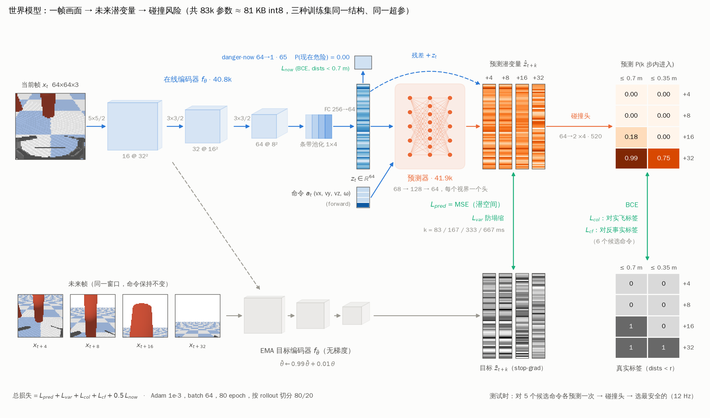
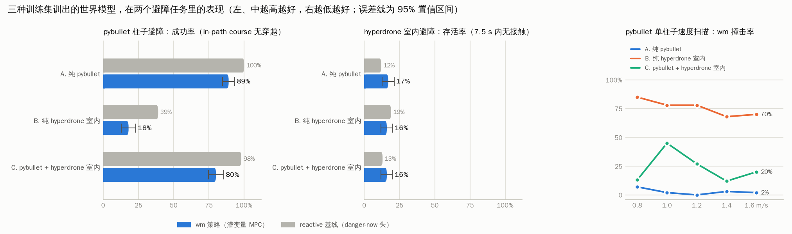
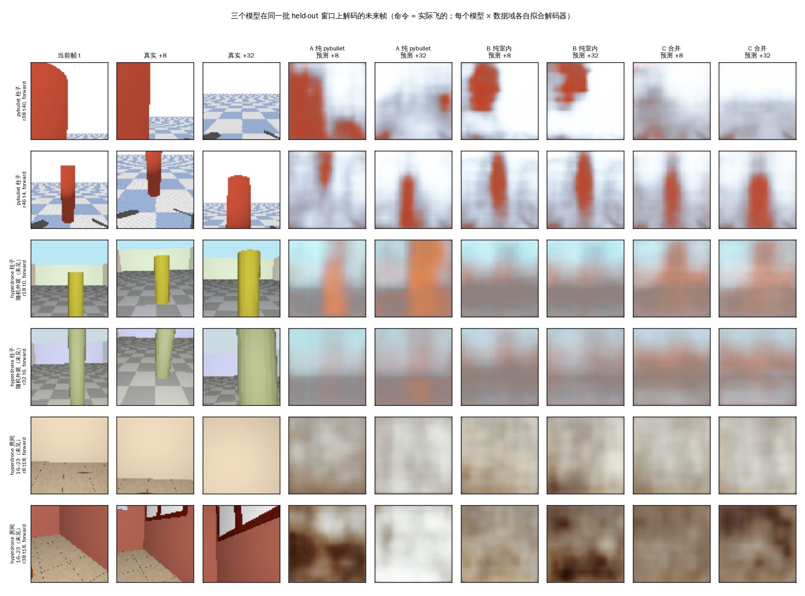
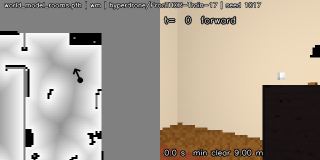

# 三种训练集 × 两个避障任务：世界模型的表现对比

[English version / 英文版](REPORT_en.md)

同一套 world model（nanodrone-ai 第 29 课的 V-JEPA 风格潜变量模型 + 碰撞头 + MPC 避障策略，`train_world_model.py --epochs 80`，三个模型完全相同的训练脚本与超参）分别在三种数据集上训练，然后在两个避障任务里闭环测试。所有脚本和每个参数的说明在 [src/README_hyperdrone_dataset.md](src/README_hyperdrone_dataset.md)；更早的探索性实验（两个仿真器各自的柱子画风、随机外观、合并大数据集等）归档在 [src/output/report/REPORT_archive_2026-10-27.md](src/output/report/REPORT_archive_2026-10-27.md)。

## 1. 三种训练集

| 训练集 | 文件 | 规模 | 场景 | 大小 |
|---|---|---|---|---|
| A. 纯 pybullet | `wm_dataset.npz` | 64 条 × 120 步 | 柱子 64 / 房间 0（0 栋） | 4 MB |
| B. 纯 hyperdrone 室内 | `wm_dataset_rooms_train60.npz` | 256 条 × 120 步 | 柱子 0 / 房间 256（16 栋） | 106 MB |
| C. pybullet + hyperdrone 室内 | `wm_dataset_pb_plus_rooms.npz` | 320 条 × 120 步 | 柱子 64 / 房间 256（16 栋） | 110 MB |

- **A. 纯 pybullet**：原课程 `gen_wm_dataset.py` 生成的柱子 course（gym-pybullet-drones，CF2X + PID，64×64、60° 机体相机）。
- **B. 纯 hyperdrone 室内**：`gen_wm_dataset_hyperdrone.py --scene rooms`，ProcTHOR 目录 0–15 号共 16 栋家具房屋里各 16 条 rollout（hyperlux 光追，crazyflie + RAPTOR，同样的 64×64、60° 机体相机）；"危险"标签来自每栋房子在飞行高度的占据栅格 / 距离场（`wm_rooms.py`）。
- **C. 合并**：A 与 B 按 rollout 拼接（`merge_datasets.py`）。

三者共享同一套动作词表（forward / slow / veer_left / veer_right / climb / hover，约 1 s 的 held segment）、同样的 4/8/16/32 步（83–667 ms）碰撞标签和反事实标签格式。

## 2. 训练（各自 held-out rollout 上的离线指标）

| 训练集 | checkpoint | 训练 / 验证窗口 | latent MSE@32（no-op） | AUC@4/8/16/32 | now-AUC | veer-ranking |
|---|---|---|---|---|---|---|
| A. 纯 pybullet | `world_model_pybullet_ref.pth` | 2444 / 580 | 1.603 (2.835) | 0.93/0.91/0.92/0.93 | 0.84 | 1.00 (n=45) |
| B. 纯 hyperdrone 室内 | `world_model_rooms.pth` | 9664 / 2408 | 0.549 (0.601) | 0.62/0.64/0.62/0.57 | 0.72 | nan (n=0) |
| C. pybullet + hyperdrone 室内 | `world_model_pb_plus_rooms.pth` | 12089 / 3007 | 0.441 (0.616) | 0.81/0.80/0.79/0.76 | 0.81 | 0.87 (n=45) |

训练流程（`train_world_model.py`）从数据集到 checkpoint：64×64 的画面经三层卷积编码器和保留左右方位的条带池化得到 64 维潜变量；动作条件预测器以残差形式预测 4/8/16/32 步后的潜变量；碰撞头从预测的潜变量读出"k 步内进入 0.7 m / 0.35 m"的概率，danger-now 头从当前潜变量读出"现在就危险"。预测目标来自编码器的 EMA 副本（JEPA 式，不用像素损失），碰撞头还用数据集里 6 个候选命令的反事实 oracle 监督。整套模型 83k 参数（int8 约 81 KB）。图中上排是在线模型，下排是同一窗口的目标（EMA 潜变量、真实距离标签），每条绿色竖向双箭头就是上面的预测与下面的目标之间的一项损失；画面、潜变量条和概率格子都来自一个 held-out 窗口和模型 A 的实际前向。



## 3. 两个测试任务

**pybullet 柱子避障**（原课程的记分板，`eval_world_model_policy.py` / `speed_sweep.py`，conda env `drone_python`）：300 条随机 course（210 条正前方有柱子，90 条直飞安全），每条 360 步、3 m 终点线，策略每 1/12 s 从 64×64 画面决策；到柱心平面距离 < 0.22 m 记为穿越。另有单柱子速度扫描：每档速度 60 条 course，巡航 0.8 → 1.6 m/s。

**hyperdrone 室内避障**（`hd_closed_loop.py --scene rooms`，conda env `dreamer`）：在训练从未用过的 ProcTHOR 16–23 号共 8 栋房子里随机取 300 个起点（净空 ≥ 0.9 m、前方 ≥ 2 m 空、随机航向），策略照常"无威胁就前进、有威胁就绕"，直到第一次接触障碍（距离场表面净空 + 0.18 m < 0.22 m，与柱子同一判定）或 7.5 s 到时。ProcTHOR 房子里几乎不存在柱子式的 course（独立障碍 + 3 m 直路 + 两侧可绕），所以室内用生存测试。

两个任务里 reactive 基线（同一 checkpoint 的 danger-now 头 + 特权绕行方向）和 wm 策略共用编码器，所以都随训练集变化；wm 策略才是世界模型的用法。

## 4. 结果



### 4.1 pybullet 柱子避障

| 训练集 | 撞击率 reactive → wm（±95% CI） | 最小净空 | wm 比 reactive 提前触发 | 清场 course 误触发 | 速度扫描 wm 撞击率 @0.8/1.0/1.2/1.4/1.6 m/s |
|---|---|---|---|---|---|
| A. 纯 pybullet | 0% → **11%** (±4) | 0.41 → 0.38 m | 335 ms (n=210) | 0% → 0% | 7% / 2% / 0% / 3% / 2% |
| B. 纯 hyperdrone 室内 | 61% → **82%** (±5) | 0.20 → 0.15 m | 276 ms (n=91) | 1% → 100% | 85% / 78% / 78% / 68% / 70% |
| C. pybullet + hyperdrone 室内 | 2% → **20%** (±5) | 0.42 → 0.32 m | 369 ms (n=210) | 100% → 100% | 13% / 45% / 27% / 12% / 20% |

### 4.2 hyperdrone 室内避障（未见过的房子）

| 训练集 | 存活率 reactive → wm（±95% CI） | 首次接触时间 | 平均飞行时间 | 平均飞行距离 | 平均净空 | 至少绕行一次 |
|---|---|---|---|---|---|---|
| A. 纯 pybullet | 12% → **17%** (±4) | 4.3 → 4.7 s | 4.7 → 5.2 s | 3.56 → 3.73 m | 1.05 → 1.06 m | 43% → 84% |
| B. 纯 hyperdrone 室内 | 19% → **16%** (±4) | 4.8 → 4.9 s | 5.3 → 5.3 s | 3.90 → 3.81 m | 1.02 → 1.02 m | 81% → 88% |
| C. pybullet + hyperdrone 室内 | 13% → **16%** (±4) | 4.7 → 4.7 s | 5.1 → 5.1 s | 3.75 → 3.73 m | 1.02 → 1.01 m | 73% → 88% |

**上限检验（`hd_oracle.py`）。** 同样的 300 个起点，换成一个直接读取房子距离场、不看图像也不用世界模型的特权策略，但限制在 wm 策略同样的动作菜单里：前进，或 0.5 s 的左右平移，偏航固定。wm 策略的选择器只会在两个平移之间挑，所以这就是任何视觉模型在这个菜单里能做到的最好成绩。第二个变体允许在所有移动候选都会在 0.3 m 内接触时悬停。

| 策略 | 存活率（±95% CI） | 平均飞行时间 | 平均飞行距离 | 至少绕行一次 |
|---|---|---|---|---|
| oracle，MPC 动作菜单（前进 / 0.5 s 左右平移、偏航固定） | **32%** (±5) | 5.9 s | 4.41 m | 99% |
| oracle + 被堵住就悬停 | **89%** (±4) | 7.2 s | 4.34 m | 99% |

### 4.3 补充：离线预测指标（held-out 帧；\* = 该域参与了训练）

数据域：pybullet 柱子；hyperdrone 柱子，随机外观（没有任何模型见过）；hyperdrone 房间 0–15（B、C 的训练域）；hyperdrone 房间 16–23（未见过）。指标：碰撞预判 AUC（0.5 = 随机）、安全绕行方向排序准确率（0.5 = 随机）、潜变量 / 解码未来帧相对"未来 = 现在"的预测增益（0 = 没有预测能力）。

**碰撞预判 AUC@32（0.5 = 随机）**

| 训练数据 \ 数据域 | pybullet pillars | hyperdrone pillars, random appearance (unseen) | hyperdrone rooms, houses 0-15 | hyperdrone rooms, houses 16-23 (unseen) |
|---|---|---|---|---|
| pybullet 64 (retrained) | 0.95\* | 0.85 | 0.51 | 0.46 |
| hyperdrone rooms 256 | 0.44 | 0.57 | 0.76\* | 0.69 |
| pybullet 64 + hyperdrone rooms 256 | 0.96\* | 0.81 | 0.77\* | 0.69 |

**碰撞预判 AUC@8**

| 训练数据 \ 数据域 | pybullet pillars | hyperdrone pillars, random appearance (unseen) | hyperdrone rooms, houses 0-15 | hyperdrone rooms, houses 16-23 (unseen) |
|---|---|---|---|---|
| pybullet 64 (retrained) | 0.95\* | 0.82 | 0.48 | 0.43 |
| hyperdrone rooms 256 | 0.45 | 0.58 | 0.71\* | 0.66 |
| pybullet 64 + hyperdrone rooms 256 | 0.96\* | 0.77 | 0.74\* | 0.68 |

**danger-now AUC**

| 训练数据 \ 数据域 | pybullet pillars | hyperdrone pillars, random appearance (unseen) | hyperdrone rooms, houses 0-15 | hyperdrone rooms, houses 16-23 (unseen) |
|---|---|---|---|---|
| pybullet 64 (retrained) | 0.87\* | 0.54 | 0.41 | 0.41 |
| hyperdrone rooms 256 | 0.45 | 0.52 | 0.72\* | 0.69 |
| pybullet 64 + hyperdrone rooms 256 | 0.90\* | 0.67 | 0.71\* | 0.74 |

**安全绕行方向排序准确率（0.5 = 随机）**

| 训练数据 \ 数据域 | pybullet pillars | hyperdrone pillars, random appearance (unseen) | hyperdrone rooms, houses 0-15 | hyperdrone rooms, houses 16-23 (unseen) |
|---|---|---|---|---|
| pybullet 64 (retrained) | 0.93\* | 0.89 | 0.45 | 0.21 |
| hyperdrone rooms 256 | 0.57 | 0.35 | 0.62\* | 0.18 |
| pybullet 64 + hyperdrone rooms 256 | 0.85\* | 0.50 | 0.50\* | 0.48 |

**潜变量预测增益 @32（0 = 不比「未来 = 现在」好）**

| 训练数据 \ 数据域 | pybullet pillars | hyperdrone pillars, random appearance (unseen) | hyperdrone rooms, houses 0-15 | hyperdrone rooms, houses 16-23 (unseen) |
|---|---|---|---|---|
| pybullet 64 (retrained) | +0.80\* | +0.43 | -1.44 | -1.10 |
| hyperdrone rooms 256 | -0.01 | -0.06 | +0.07\* | -0.00 |
| pybullet 64 + hyperdrone rooms 256 | +0.66\* | +0.11 | -0.01\* | +0.01 |

**解码未来帧增益 @32（0 = 不比复制当前帧好）**

| 训练数据 \ 数据域 | pybullet pillars | hyperdrone pillars, random appearance (unseen) | hyperdrone rooms, houses 0-15 | hyperdrone rooms, houses 16-23 (unseen) |
|---|---|---|---|---|
| pybullet 64 (retrained) | +0.64\* | +0.33 | -0.58 | -0.54 |
| hyperdrone rooms 256 | +0.28 | +0.27 | +0.12\* | -0.06 |
| pybullet 64 + hyperdrone rooms 256 | +0.57\* | +0.37 | +0.10\* | +0.04 |

\* = 该数据域参与了这个 checkpoint 的训练（in-sample）；其余单元格是训练时没见过的数据。

### 4.4 解码的未来帧：预测 vs 真实

世界模型预测的是下一步的潜变量，不是像素。为了看每个模型"想象"了什么，对每个模型 × 数据域各拟合一个小解码器（64 维潜变量 → 64×64 RGB，编码器冻结，用该域 80% 的 rollout），然后在剩下 20% 的窗口上，把实际飞行命令对应的预测潜变量在 +8 和 +32 步（167 / 667 ms）解码出来，与真实的未来帧并排（`decode_compare.py`）。三个模型看的是同一批窗口。表里的数字是解码未来帧增益 1 − MSE(decode(ẑ₊ₖ), x₊ₖ) / MSE(xₜ, x₊ₖ)：0 表示不比复制当前帧好，负数表示更差（\* = 该域参与了训练）。注意：预测器训练时对齐的是 EMA 目标编码器，其权重没有保存，解码器只能用在线编码器的潜变量拟合，所以解码结果在 64 维潜变量本身的信息上限之外还带着这一点失配，看到的应是位置正确的模糊形状，而不是照片。

| 训练集 \ 数据域（增益 @8 / @32） | pybullet 柱子 | hyperdrone 柱子，随机外观（未见） | hyperdrone 房间 16–23（未见） |
|---|---|---|---|
| A. 纯 pybullet | +0.44 / +0.64\* | +0.07 / +0.33 | -0.35 / -0.55 |
| B. 纯 hyperdrone 室内 | +0.21 / +0.29 | +0.13 / +0.27 | -0.23 / -0.06 |
| C. pybullet + hyperdrone 室内 | +0.26 / +0.57\* | +0.06 / +0.36 | -0.10 / +0.09 |



## 5. 过程视频

pybullet 4 行柱子森林（`forest_demo.py --rows 4`，左俯视轨迹 + 右机载画面）：

**A. 纯 pybullet** — [mp4](src/output/report/forest_pb_ref_wm-mpc.mp4)


**B. 纯 hyperdrone 室内** — [mp4](src/output/report/forest_pb_rooms_wm-mpc.mp4)


**C. 合并** — [mp4](src/output/report/forest_pb_pb_plus_rooms_wm-mpc.mp4)


hyperdrone 室内（17 号房子，seed 1017，同一起点；左侧占据栅格地图 + 轨迹，右侧策略看到的 64×64 画面）：

**A. 纯 pybullet** — [mp4](src/output/report/hd_room17_pybullet_ref.mp4)


**B. 纯 hyperdrone 室内** — [mp4](src/output/report/hd_room17_rooms.mp4)



**C. 合并** — [mp4](src/output/report/hd_room17_pb_plus_rooms.mp4)


## 6. 结论

1. **pybullet 柱子避障：纯 pybullet 训练的模型最好，合并室内数据反而变差，纯室内模型完全不迁移。** 300 条 course 上 wm 策略的撞击率 A 11%、C 20%、B 82%。B 没见过柱子也没见过 pybullet 的画面，碰撞头在那里接近随机（离线 AUC 0.44）；C 比 A 差 9 个百分点（置信区间 ±4，差异真实），这是把 256 条域外室内 rollout 并进 64 条 pybullet 数据后，pybullet 分布被稀释、碰撞头的概率标定改变，而 MPC 的触发阈值仍按 pybullet 模型调定的结果。
2. **hyperdrone 室内避障：三个模型的存活率并列（16–17%，置信区间 ±4），室内数据没有带来室内优势。** 但离线指标显示 B、C 确实比 A 更能预见室内危险：在没见过的 16–23 号房子里碰撞预判 AUC 0.69 对 A 的 0.46（随机水平），danger-now AUC 0.69–0.74 对 0.41。预见到了却活不下来，说明室内任务现在卡在**策略**而不是世界模型上：这个 MPC 只有"0.5 s 的左/右脉冲 + 回中先验"，房间里需要的是沿墙、过门、绕家具的持续导航，预判到危险也没有合适的动作可选；4.2 的上限检验证实了这一点：一个直接读取房间几何、但限制在同样动作菜单里的特权策略也只有 32% 存活，允许被堵住时悬停后才到 89%。视觉模型的 16–17% 已经是这个动作空间允许的一半；A 靠"前方出现大块近物就触发"这种通用反应拿到了同样的存活率。
3. **只用室内数据，世界模型几乎学不到预测。** B 的潜变量预测误差 0.549 对 no-op 0.601（提升不到 10%），held-out AUC@32 只有 0.57，解码出的未来帧在未见房子里不比复制当前帧好；加上 64 条 pybullet 柱子数据后（C）AUC@32 升到 0.76、veer-ranking 0.87。柱子数据给潜空间提供了"障碍 = 前方逐渐变大的物体"这个简单骨架，房间数据单独撑不起这个 64 维潜变量 + 潜空间 MSE 的目标。4.4 的解码图直观地显示了这一点：同一个正前方的柱子，A 在 +32 步把它画得明显变大，B 在 +8 和 +32 画出的柱子几乎一样大（等于"未来 = 现在"），C 介于两者之间；在没见过的房间里三个模型都只能画出墙和地面的大色块，没有任何家具。
4. **对没见过的外观的鲁棒性由 pybullet 数据提供，不是室内数据。** 随机外观柱子上碰撞预判 AUC：A 0.85、C 0.81、B 0.57。
5. **对真机的含义。** (a) 现在的室内数据训不出能在室内飞的策略，先要解决的是 MPC 的动作空间和目标层（允许悬停、持续转向、沿墙、目标点），然后才是数据量（256 条、16 栋房子远远不够）和潜变量目标（更高维、对比式或带像素/深度辅助监督）。(b) 就现有模型而言，真机上更值得试的是 A 或 C（含 pybullet 数据），并在生成 hyperdrone 数据时开外观随机化。(c) 评估以未见域的碰撞预判 AUC 和绕行排序为主，闭环生存率要和策略改动一起看；部署前用真机 shadow 推理复测。
6. 说明：A 用的是同一脚本重训的 `world_model_pybullet_ref.pth`，不是仓库自带的 `world_model.pth`，以保证三者训练条件一致；自带权重更鲁棒（见归档报告）。

## 7. 复现

```bash
# 数据（conda env dreamer）
python src/gen_wm_dataset_hyperdrone.py --scene rooms --rollouts 256 --rooms 256 --houses 16 --house-first 0 --len 120 --fov-deg 60 --camera body --out src/output/wm_dataset_rooms_train60.npz
python src/merge_datasets.py src/output/wm_dataset.npz src/output/wm_dataset_rooms_train60.npz --out src/output/wm_dataset_pb_plus_rooms.npz
# 训练（GPU）
python src/train_world_model.py --epochs 80 --data src/output/wm_dataset_rooms_train60.npz --out src/output/world_model_rooms.pth
# pybullet 任务（conda env drone_python）
python src/eval_world_model_policy.py --seeds 300 --model src/output/world_model_rooms.pth
python src/speed_sweep.py --seeds 60 --no-learned --model src/output/world_model_rooms.pth --plot src/output/speed_sweep_rooms.png
# hyperdrone 室内任务及其 oracle 上限（conda env dreamer）
python src/hd_closed_loop.py --scene rooms --houses 8 --house-first 16 --seeds 300 --sweep-seeds 0 --model src/output/world_model_rooms.pth
python src/hd_oracle.py --houses 8 --house-first 16 --seeds 300 | tee src/output/evals/oracle_rooms.log
# 离线预测指标、视频、本报告
python src/eval_offline.py --models pybullet_ref rooms pb_plus_rooms --domains pybullet rand_pillars rooms_train rooms_unseen --out three_way
python src/hd_video.py --scene rooms --house 17 --seed 1017 --model src/output/world_model_rooms.pth --tag room17_rooms
python src/decode_compare.py --lang both
python src/draw_pipeline.py --lang both
python src/make_report_three.py --lang zh
```
