# hyperdrone 数据 × pybullet 世界模型：数据、训练、闭环测试与预测可视化

本报告汇总 2026-10-27 在 `drone_ws` 上做的实验：用 hyperdrone（hyperlux 光追 + L2F/RAPTOR 动力学）生成与 nanodrone-ai 第 29 课同格式的 world-model 数据集（柱子场景 + ProcTHOR 真实房间），用原课程的 `train_world_model.py` 训练 V-JEPA 风格的潜变量世界模型和 MPC 避障策略，然后在 **pybullet 柱子环境**和 **hyperdrone 柱子环境**（两种画风）里闭环测试，并把模型在潜空间里的预测解码成图片。生成器、评估脚本和每个参数的说明见 [src/README_hyperdrone_dataset.md](src/README_hyperdrone_dataset.md)。

## 1. 数据集

| 文件 | rollout | 柱子 / 房间 | 房子 | 相机 | 柱子画风 | 阳性率@32 | 大小 |
|---|---|---|---|---|---|---|---|
| `wm_dataset.npz`（pybullet 原版） | 64 | 64 / 0 | – | 60° body | pybullet 真渲染 | 0.37 | 4.2 MB |
| `wm_dataset_hyperdrone.npz` | 64 | 64 / 0 | – | 60° body | hyperdrone | 0.30 | 8.8 MB |
| `wm_dataset_hyperdrone_tello40.npz` | 64 | 64 / 0 | – | 40° level | hyperdrone | 0.30 | 2.7 MB |
| `wm_dataset_hyperdrone_tello40_rand.npz` | 64 | 64 / 0 | – | 40° level，随机化 | hyperdrone | 0.38 | 2.9 MB |
| `wm_dataset_mixed_tello40.npz` | 64 | 32 / 32 | 4 | 40° level | hyperdrone | 0.27 | 12.9 MB |
| `wm_dataset_mixed_60body.npz` | 64 | 32 / 32 | 4 | 60° body | hyperdrone | 0.27 | 18.7 MB |
| `wm_dataset_mixed_big_60body.npz` | 256 | 128 / 128 | 16 | 60° body | hyperdrone | 0.28 | 72.9 MB |
| `wm_dataset_mixed_big_60body_pbstyle.npz` | 256 | 128 / 128 | 16 | 60° body | pybullet 画风 | 0.28 | 77.5 MB |
| `wm_dataset_pb_plus_big.npz` | 320 | 192 / 128 | 16 | 60° body | 合并 | 0.30 | 77.1 MB |
| `wm_dataset_pb_plus_big_pbstyle.npz` | 320 | 192 / 128 | 16 | 60° body | 合并 | 0.30 | – |

每条 rollout 120 步 @ 48 Hz，64×64 RGB，六个指令（forward / slow / veer_left / veer_right / climb / hover）按约 1 s 的 held segment 随机切换，标签是"k 步内到最近障碍的平面距离 < 0.7 / 0.35 m"。柱子 course 与 pybullet 生成器共用随机数，同一 seed 同一布局；房间用 0.1 m 占据栅格 + 距离场打标签（`src/wm_rooms.py`）。

同一批柱子 course 的三种画面（左 pybullet，中 hyperdrone 的 pybullet 画风，右 hyperdrone 默认画风）：

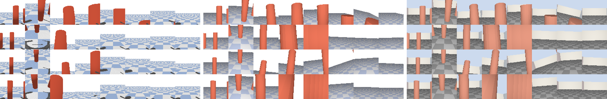

大混合集 16 栋房子各一条 rollout：

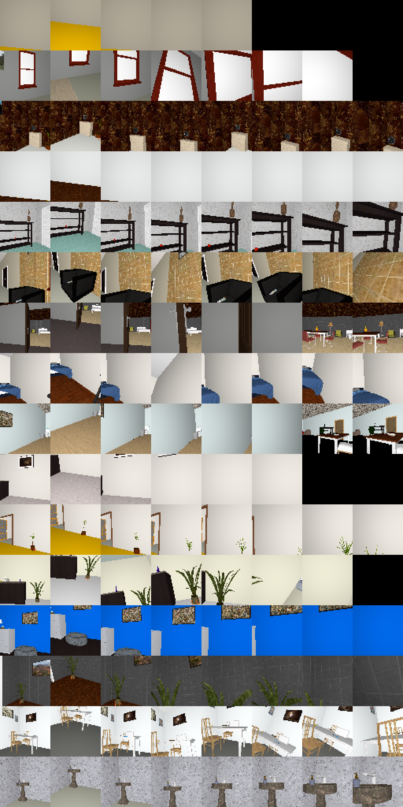

## 2. 训练

全部用原课程的 `train_world_model.py --epochs 80`（编码器 → 64 维潜变量；动作条件预测器预测 +4/8/16/32 步的潜变量；碰撞头；danger-now 头），只加了 `--data/--out`、CUDA 和"从数据集读取相机 FOV / 预存反事实标签"。离线指标在各自 held-out rollout 上：

| checkpoint | 训练数据 | 训练序列 | latent MSE@32（no-op） | AUC@4/8/16/32 | now-AUC | veer-ranking |
|---|---|---|---|---|---|---|
| `world_model.pth`（仓库自带） | pybullet 64（上游训练） | – | – | – | – | – |
| `world_model_pybullet_ref.pth` | pybullet 64 | 2444 | 1.603 (2.835) | 0.93 / 0.91 / 0.92 / 0.93 | 0.84 | 1.00 (45) |
| `world_model_mixed_big.pth` | hyperdrone 256（hd 画风） | 9643 | 1.154 (1.897) | 0.91 / 0.91 / 0.90 / 0.87 | 0.84 | 1.00 (20) |
| `world_model_mixed_big_pbstyle.pth` | hyperdrone 256（pb 画风） | 9643 | 1.054 (1.880) | 0.86 / 0.83 / 0.82 / 0.84 | 0.81 | 1.00 (100) |
| `world_model_pb_plus_big.pth` | pybullet 64 + hd 画风 256 | 12094 | 0.721 (1.439) | 0.91 / 0.89 / 0.89 / 0.86 | 0.86 | 0.97 (146) |
| `world_model_pb_plus_big_pbstyle.pth` | pybullet 64 + pb 画风 256 | 12094 | 0.582 (1.439) | 0.90 / 0.89 / 0.88 / 0.86 | 0.85 | 0.91 (145) |

## 3. 世界模型的预测能力与跨域泛化（核心）

真机飞行关心的不是某个 checkpoint 能不能在某一个仿真器的柱子 course 上活下来，而是它带的世界模型在**没见过的数据**上还能不能预测：能不能预见碰撞（碰撞头）、能不能分辨往哪边绕更安全（动作条件化）、潜变量是不是真的随着未来画面在动（未来帧预测）。`src/eval_offline.py` 把每个 checkpoint 放到每个数据域的 held-out 帧上打分，并标出该域是否参与过训练（\*）。

数据域：pybullet 柱子；hyperdrone 柱子（hd 画风）；hyperdrone 柱子（pb 画风）；**hyperdrone 柱子，随机外观（没有任何模型见过）**；hyperdrone 房间（训练用的 0–15 号房子）；**hyperdrone 房间，16–23 号房子（没有任何模型见过）**。每个域取 64 条 rollout（7680 帧）。没有真实 Tello 画面可用（仓库里只有标定板照片），所以"随机外观"和"未见过的房子"是本报告里最接近真机泛化的代理。

指标：

| 指标 | 含义 | 随机水平 |
|---|---|---|
| AUC@k | 从预测的潜变量判断"k 步内会进入 0.7 m 危险环"的 ROC-AUC，k = 4/8/16/32（83–667 ms），只在指令被持有的窗口上算 | 0.5 |
| danger-now AUC | danger-now 头（反应式信号）的 AUC | 0.5 |
| 安全绕行排序 | 反事实标签说一侧绕行危险、另一侧安全（两侧都在视野内）的帧上，模型把安全一侧排得更安全的比例；房间用距离场的标签 | 0.5 |
| 潜变量预测增益 | 1 − MSE(ẑ_{t+32}, z_{t+32}) / MSE(z_t, z_{t+32})：预测器解释了多少潜变量在 32 步内的变化 | 0 |
| 解码未来帧增益 | 冻结编码器，在该域 80% 的 rollout 上拟合一个小解码器，在另外 20% 上算 1 − MSE(decode(ẑ_{t+32}), x_{t+32}) / MSE(x_t, x_{t+32})：解码出的预测帧比"复制当前帧"好多少 | 0 |

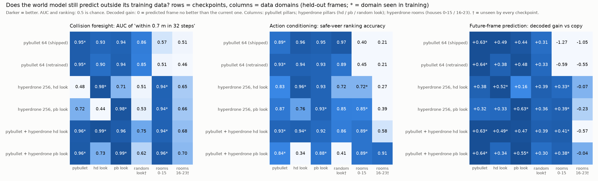

**碰撞预判 AUC@32（0.5 = 随机）**

| 训练数据 \ 数据域 | pybullet pillars | hyperdrone pillars, hd look | hyperdrone pillars, pb look | hyperdrone pillars, random appearance (unseen) | hyperdrone rooms, houses 0-15 | hyperdrone rooms, houses 16-23 (unseen) |
|---|---|---|---|---|---|---|
| pybullet 64 (shipped) | 0.95\* | 0.93 | 0.94 | 0.86 | 0.57 | 0.51 |
| pybullet 64 (retrained) | 0.95\* | 0.90 | 0.94 | 0.85 | 0.51 | 0.46 |
| hyperdrone 256, hd look | 0.48 | 0.98\* | 0.71 | 0.51 | 0.94\* | 0.65 |
| hyperdrone 256, pb look | 0.72 | 0.44 | 0.98\* | 0.53 | 0.94\* | 0.66 |
| pybullet + hyperdrone hd look | 0.96\* | 0.99\* | 0.96 | 0.75 | 0.94\* | 0.68 |
| pybullet + hyperdrone pb look | 0.96\* | 0.73 | 0.99\* | 0.62 | 0.96\* | 0.70 |

**碰撞预判 AUC@8**

| 训练数据 \ 数据域 | pybullet pillars | hyperdrone pillars, hd look | hyperdrone pillars, pb look | hyperdrone pillars, random appearance (unseen) | hyperdrone rooms, houses 0-15 | hyperdrone rooms, houses 16-23 (unseen) |
|---|---|---|---|---|---|---|
| pybullet 64 (shipped) | 0.95\* | 0.91 | 0.95 | 0.86 | 0.56 | 0.46 |
| pybullet 64 (retrained) | 0.95\* | 0.85 | 0.95 | 0.82 | 0.48 | 0.43 |
| hyperdrone 256, hd look | 0.37 | 0.99\* | 0.60 | 0.48 | 0.95\* | 0.62 |
| hyperdrone 256, pb look | 0.70 | 0.41 | 0.99\* | 0.46 | 0.91\* | 0.61 |
| pybullet + hyperdrone hd look | 0.96\* | 0.99\* | 0.95 | 0.61 | 0.96\* | 0.64 |
| pybullet + hyperdrone pb look | 0.97\* | 0.70 | 0.99\* | 0.46 | 0.96\* | 0.69 |

**danger-now AUC**

| 训练数据 \ 数据域 | pybullet pillars | hyperdrone pillars, hd look | hyperdrone pillars, pb look | hyperdrone pillars, random appearance (unseen) | hyperdrone rooms, houses 0-15 | hyperdrone rooms, houses 16-23 (unseen) |
|---|---|---|---|---|---|---|
| pybullet 64 (shipped) | 0.88\* | 0.73 | 0.89 | 0.63 | 0.43 | 0.40 |
| pybullet 64 (retrained) | 0.87\* | 0.55 | 0.88 | 0.54 | 0.41 | 0.41 |
| hyperdrone 256, hd look | 0.42 | 0.95\* | 0.53 | 0.50 | 0.94\* | 0.69 |
| hyperdrone 256, pb look | 0.57 | 0.39 | 0.94\* | 0.43 | 0.94\* | 0.69 |
| pybullet + hyperdrone hd look | 0.90\* | 0.96\* | 0.83 | 0.55 | 0.96\* | 0.70 |
| pybullet + hyperdrone pb look | 0.91\* | 0.47 | 0.95\* | 0.44 | 0.95\* | 0.70 |

**安全绕行方向排序准确率（0.5 = 随机）**

| 训练数据 \ 数据域 | pybullet pillars | hyperdrone pillars, hd look | hyperdrone pillars, pb look | hyperdrone pillars, random appearance (unseen) | hyperdrone rooms, houses 0-15 | hyperdrone rooms, houses 16-23 (unseen) |
|---|---|---|---|---|---|---|
| pybullet 64 (shipped) | 0.89\* | 0.96 | 0.95 | 0.97 | 0.40 | 0.21 |
| pybullet 64 (retrained) | 0.93\* | 0.94 | 0.93 | 0.89 | 0.45 | 0.21 |
| hyperdrone 256, hd look | 0.83 | 0.96\* | 0.93 | 0.72 | 0.72\* | 0.27 |
| hyperdrone 256, pb look | 0.87 | 0.76 | 0.93\* | 0.85 | 0.85\* | 0.39 |
| pybullet + hyperdrone hd look | 0.93\* | 0.94\* | 0.92 | 0.86 | 0.89\* | 0.58 |
| pybullet + hyperdrone pb look | 0.84\* | 0.34 | 0.88\* | 0.41 | 0.89\* | 0.91 |

**潜变量预测增益 @32（0 = 不比「未来 = 现在」好）**

| 训练数据 \ 数据域 | pybullet pillars | hyperdrone pillars, hd look | hyperdrone pillars, pb look | hyperdrone pillars, random appearance (unseen) | hyperdrone rooms, houses 0-15 | hyperdrone rooms, houses 16-23 (unseen) |
|---|---|---|---|---|---|---|
| pybullet 64 (shipped) | +0.78\* | -0.06 | +0.55 | +0.46 | -1.49 | -1.32 |
| pybullet 64 (retrained) | +0.80\* | -0.25 | +0.53 | +0.43 | -1.44 | -1.10 |
| hyperdrone 256, hd look | +0.18 | +0.83\* | +0.28 | +0.28 | +0.51\* | -0.09 |
| hyperdrone 256, pb look | +0.07 | -0.06 | +0.86\* | +0.06 | +0.48\* | -0.15 |
| pybullet + hyperdrone hd look | +0.73\* | +0.83\* | +0.68 | +0.41 | +0.65\* | -0.22 |
| pybullet + hyperdrone pb look | +0.78\* | +0.42 | +0.86\* | +0.25 | +0.46\* | -0.24 |

**解码未来帧增益 @32（0 = 不比复制当前帧好）**

| 训练数据 \ 数据域 | pybullet pillars | hyperdrone pillars, hd look | hyperdrone pillars, pb look | hyperdrone pillars, random appearance (unseen) | hyperdrone rooms, houses 0-15 | hyperdrone rooms, houses 16-23 (unseen) |
|---|---|---|---|---|---|---|
| pybullet 64 (shipped) | +0.63\* | +0.49 | +0.44 | +0.31 | -1.27 | -1.05 |
| pybullet 64 (retrained) | +0.64\* | +0.38 | +0.48 | +0.33 | -0.59 | -0.55 |
| hyperdrone 256, hd look | +0.38 | +0.52\* | +0.16 | +0.39 | +0.33\* | -0.07 |
| hyperdrone 256, pb look | +0.32 | +0.33 | +0.63\* | +0.36 | +0.39\* | -0.23 |
| pybullet + hyperdrone hd look | +0.63\* | +0.49\* | +0.47 | +0.39 | +0.41\* | -0.57 |
| pybullet + hyperdrone pb look | +0.64\* | +0.34 | +0.55\* | +0.30 | +0.38\* | -0.04 |

\* = 该数据域参与了这个 checkpoint 的训练（in-sample）；其余单元格是训练时没见过的数据。

### 3.1 每个模型在六个数据域上预测的未来帧

每行一个数据域，列为：当前帧 | 预测 +8 | 预测 +32 | 真实 +8 | 真实 +32（解码器按域拟合，指令取实际飞行的那个）。看柱子/家具的位置和大小是否按指令移动，不要看细节。

**pybullet 64（仓库自带权重）**

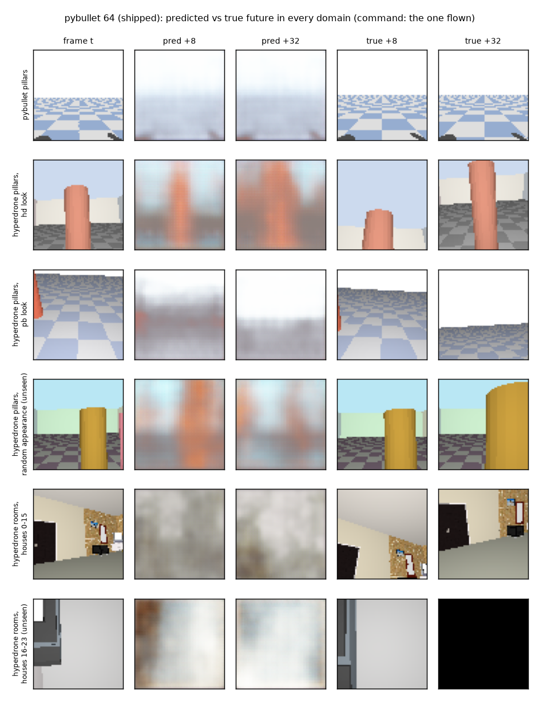

**pybullet 64（同脚本重训）**

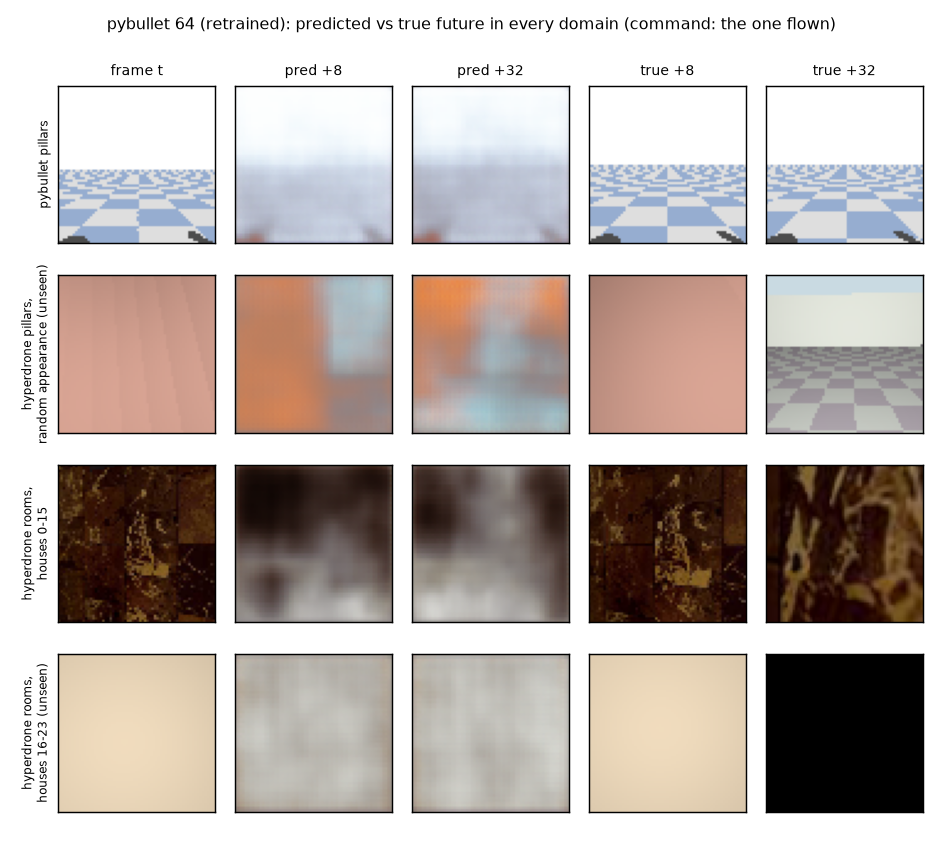

**hyperdrone 256，hd 画风**

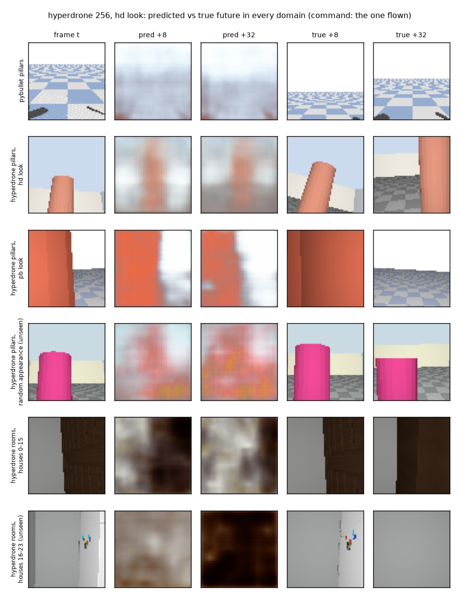

**hyperdrone 256，pb 画风**

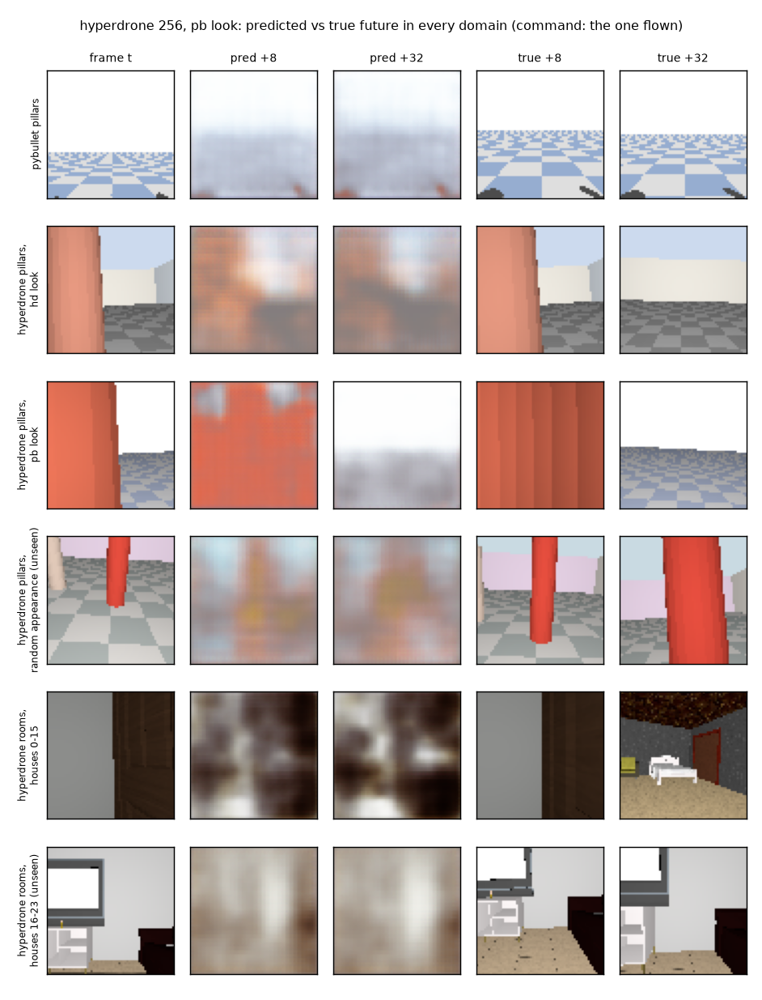

**pybullet 64 + hd 画风 256**

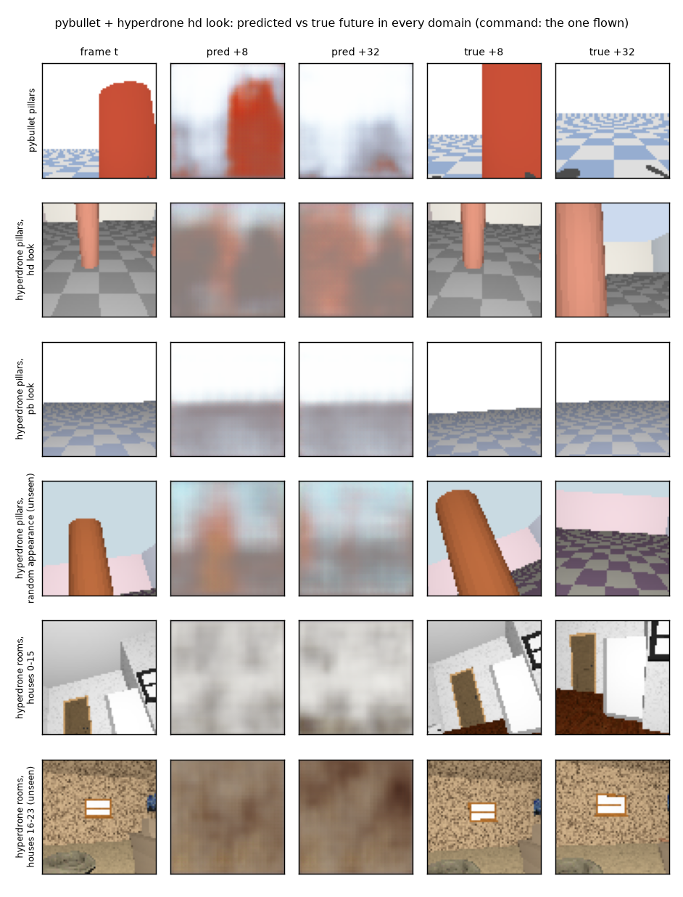

**pybullet 64 + pb 画风 256**

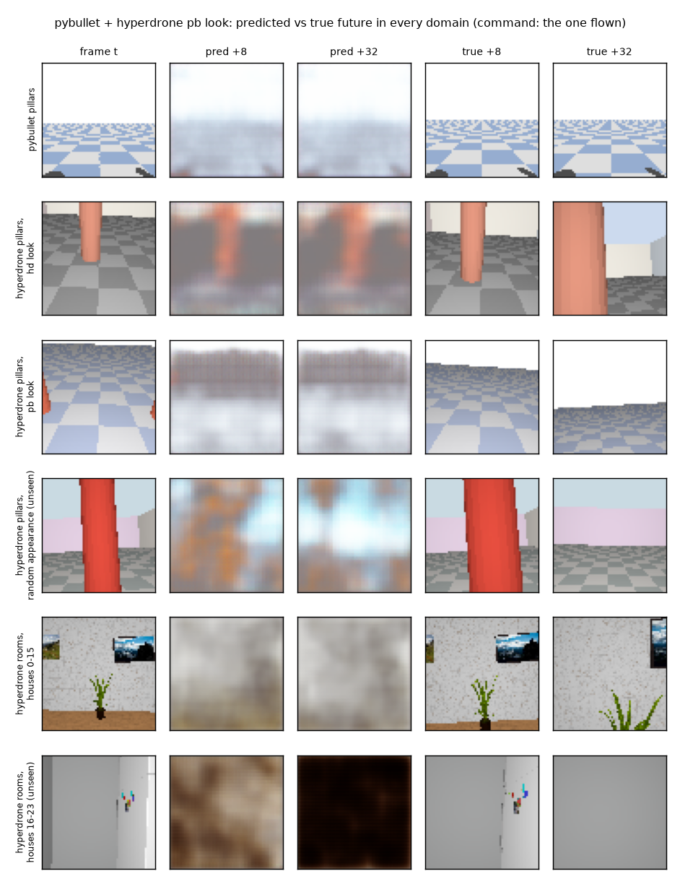


### 3.2 把潜变量解码回图片：持有指令下的预测，以及六个候选指令的想象

世界模型预测的是下一时刻的 64 维潜变量，不是像素。为了看它，`src/decode_latents.py` 冻结每个 checkpoint 的编码器，在对应数据集上训一个小解码器（潜变量 → 64×64），再把当前帧的 z、预测器给出的 z_hat(+4/8/16/32)、以及同一帧下六个候选指令的 z_hat(+32) 解码出来，和真实未来帧并排。注意预测器训练时对齐的是 EMA 目标编码器（checkpoint 里没有保存），解码器拟合的是在线编码器的潜变量，所以解码出来的预测除了 64 维本身的信息瓶颈，还带有这一点错位：看位置和尺寸，不要看细节。

held-out 窗口上解码预测与真实未来帧的像素 MSE（对照"未来 = 现在"的复制基线）：

| checkpoint → data | reconstruction MSE | decoded prediction MSE @4/8/16/32 | copy baseline MSE @4/8/16/32 |
|---|---|---|---|
| pybullet 自带权重 → pybullet 数据 | 0.0128 | 0.0204 / 0.0291 / 0.0330 / 0.0308 | 0.0306 / 0.0438 / 0.0531 / 0.0534 |
| pybullet 重训 → pybullet 数据 | 0.0125 | 0.0207 / 0.0288 / 0.0332 / 0.0304 | 0.0306 / 0.0438 / 0.0531 / 0.0534 |
| hyperdrone 大混合（hd 画风）→ 自己的数据 | 0.0242 | 0.0320 / 0.0398 / 0.0469 / 0.0541 | 0.0246 / 0.0381 / 0.0521 / 0.0618 |
| hyperdrone 大混合（pb 画风）→ 自己的数据 | 0.0265 | 0.0334 / 0.0407 / 0.0497 / 0.0564 | 0.0280 / 0.0440 / 0.0611 / 0.0731 |
| pybullet + hd 画风合并 → 自己的数据 | 0.0164 | 0.0248 / 0.0323 / 0.0388 / 0.0453 | 0.0266 / 0.0405 / 0.0536 / 0.0617 |
| pybullet 自带权重 → hyperdrone hd 画风数据（跨域，解码器沿用 pybullet 的） | 0.0705 | 0.0780 / 0.0910 / 0.1193 / 0.1736 | 0.0246 / 0.0381 / 0.0521 / 0.0618 |
| hyperdrone pb 画风权重 → pybullet 数据（跨域，解码器沿用 hyperdrone 的） | 0.0284 | 0.0317 / 0.0392 / 0.0508 / 0.0596 | 0.0306 / 0.0438 / 0.0531 / 0.0534 |

怎么读这张表：pybullet 模型（自带与重训）在 pybullet 数据上，解码出的预测在四个时域都明显好于"未来 = 现在"的复制基线（0.030 对 0.021，0.053 对 0.030），说明潜变量里确实有运动信息；hyperdrone 大混合模型只在 +16/+32 步赢过复制基线——它的解码器重建误差本身就有 0.024，因为房间画面比柱子复杂得多，64 维潜变量装不下细节，这不等于预测器没学到东西（它的 latent MSE 相对 no-op 的提升在离线指标里是清楚的）。两行跨域最能说明问题：pybullet 权重看 hyperdrone 画面，连当前帧都重建不出来（0.07，比复制基线差三倍），它的潜空间对这些画面没有可用的表达；反过来 hyperdrone pb 画风权重看 pybullet 画面，预测和复制基线打平，是"看得懂一半"的状态，和闭环里 54% 的撞击率对应。

**pybullet 重训权重 → pybullet 数据 — 持有指令下的预测 vs 真实未来**

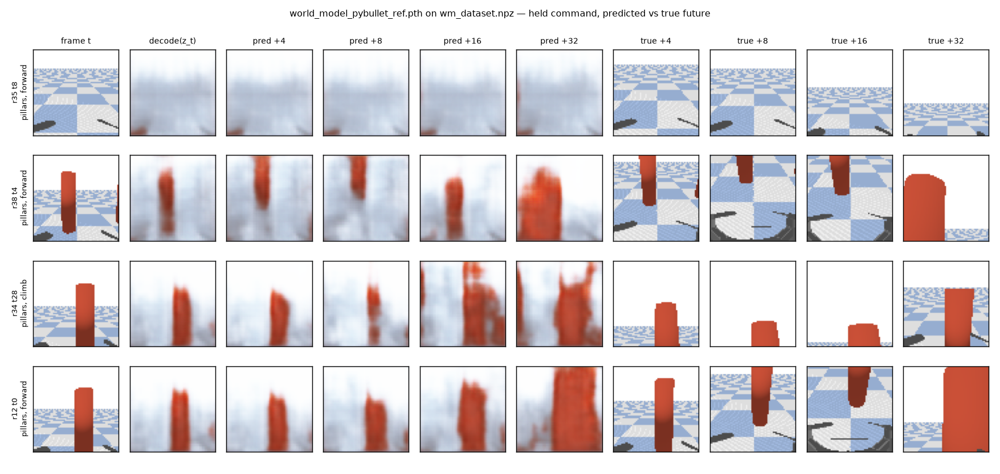

**pybullet 重训权重 → pybullet 数据 — 同一帧下六个候选指令在 +32 步的想象，以及碰撞头给出的 P(warn)/P(crit)**

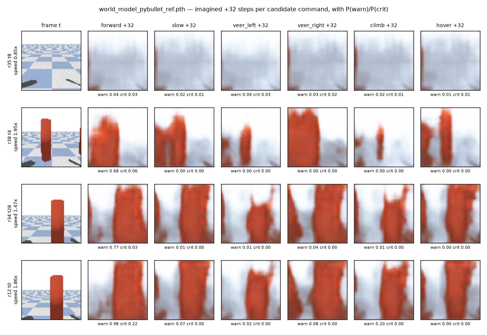


**pybullet 自带权重 → pybullet 数据 — 持有指令下的预测 vs 真实未来**

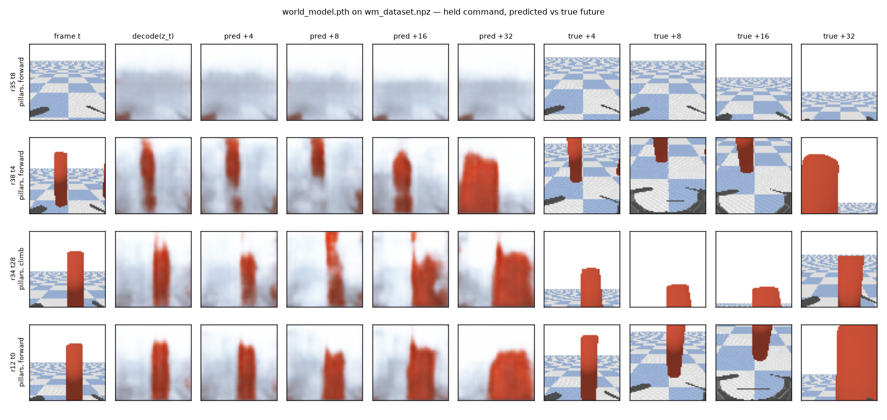

**pybullet 自带权重 → pybullet 数据 — 同一帧下六个候选指令在 +32 步的想象，以及碰撞头给出的 P(warn)/P(crit)**

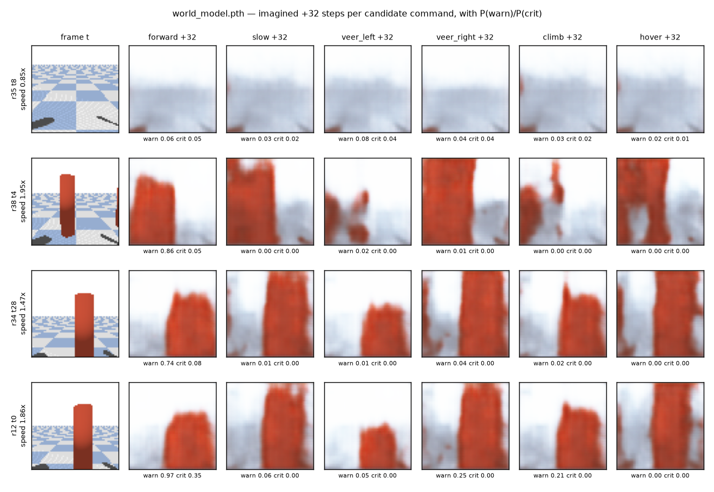


**hyperdrone 大混合权重 → 自己的数据（柱子与房间交替） — 持有指令下的预测 vs 真实未来**

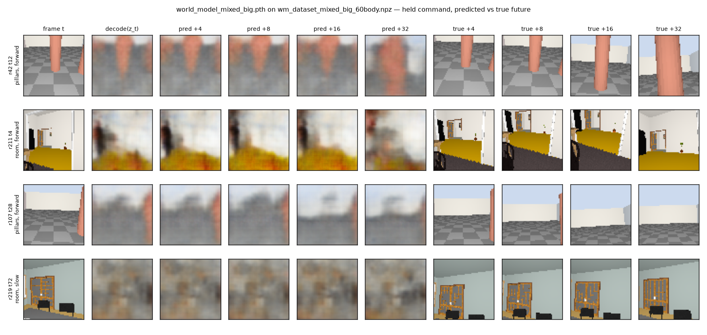

**hyperdrone 大混合权重 → 自己的数据（柱子与房间交替） — 同一帧下六个候选指令在 +32 步的想象，以及碰撞头给出的 P(warn)/P(crit)**

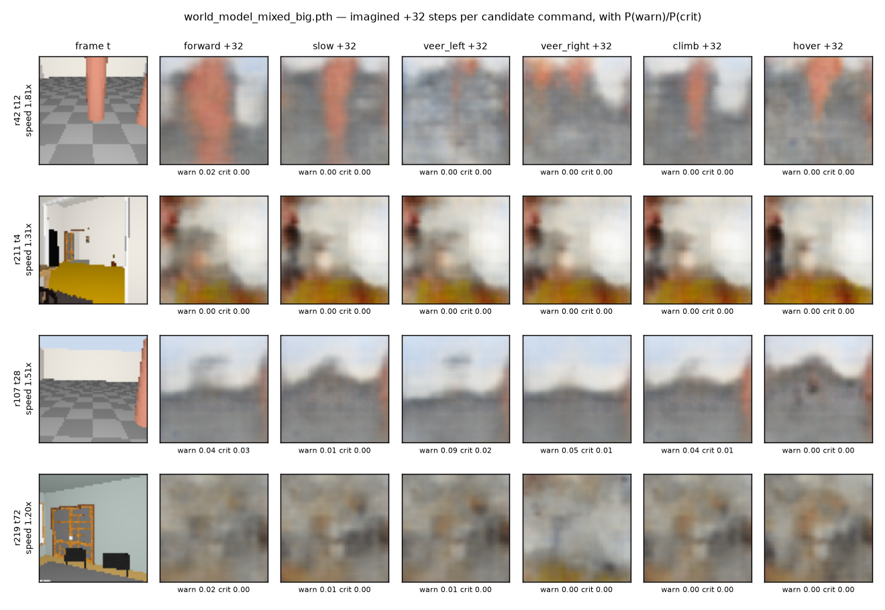


**hyperdrone pb 画风权重 → 自己的数据 — 持有指令下的预测 vs 真实未来**

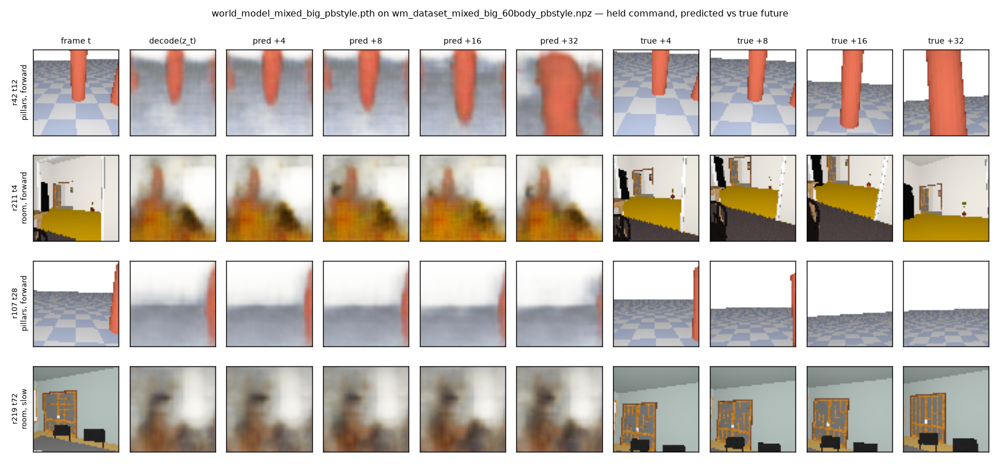

**hyperdrone pb 画风权重 → 自己的数据 — 同一帧下六个候选指令在 +32 步的想象，以及碰撞头给出的 P(warn)/P(crit)**

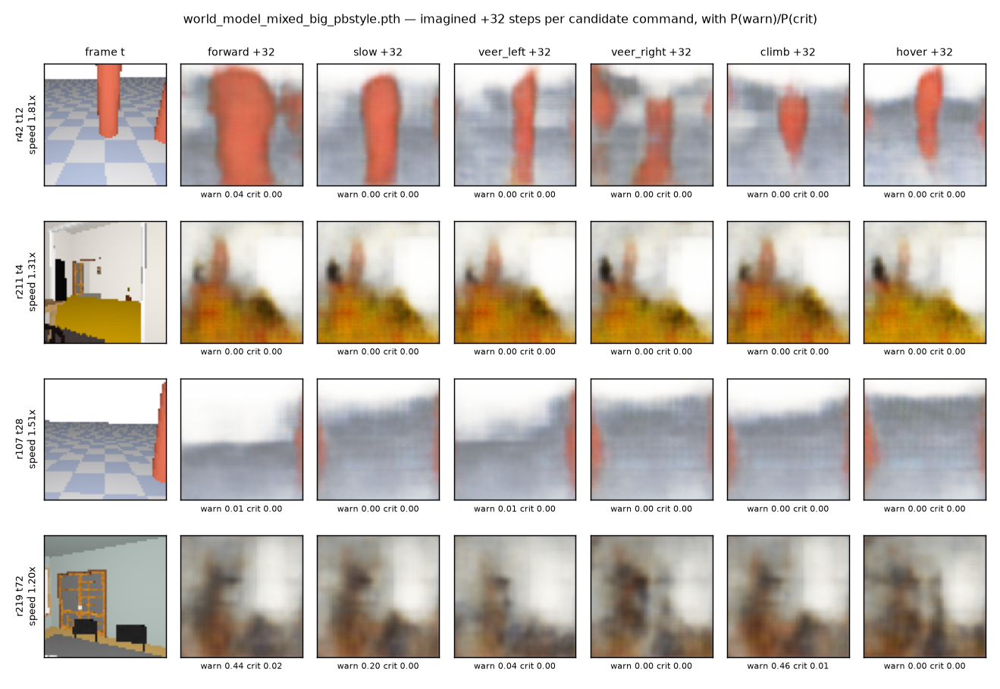


**pybullet + hyperdrone 合并权重 → 合并数据 — 持有指令下的预测 vs 真实未来**

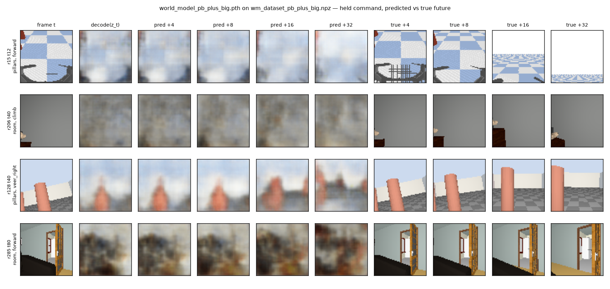

**pybullet + hyperdrone 合并权重 → 合并数据 — 同一帧下六个候选指令在 +32 步的想象，以及碰撞头给出的 P(warn)/P(crit)**

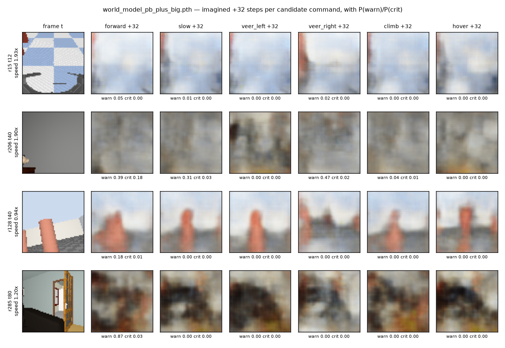


**跨域：pybullet 自带权重看 hyperdrone 画面 — 持有指令下的预测 vs 真实未来**

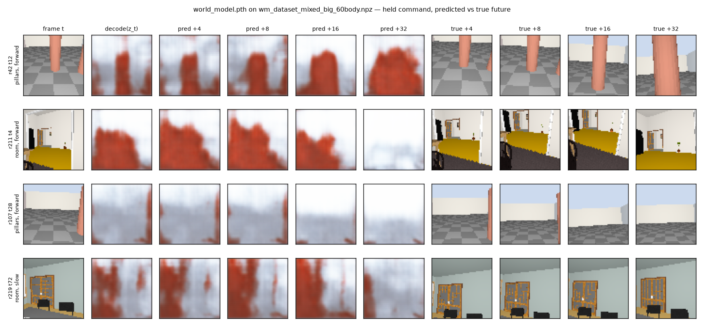

**跨域：pybullet 自带权重看 hyperdrone 画面 — 同一帧下六个候选指令在 +32 步的想象，以及碰撞头给出的 P(warn)/P(crit)**

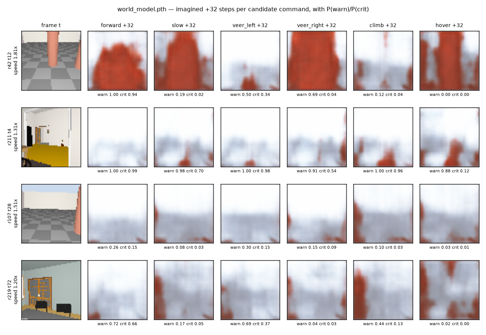


**跨域：hyperdrone pb 画风权重看 pybullet 画面 — 持有指令下的预测 vs 真实未来**

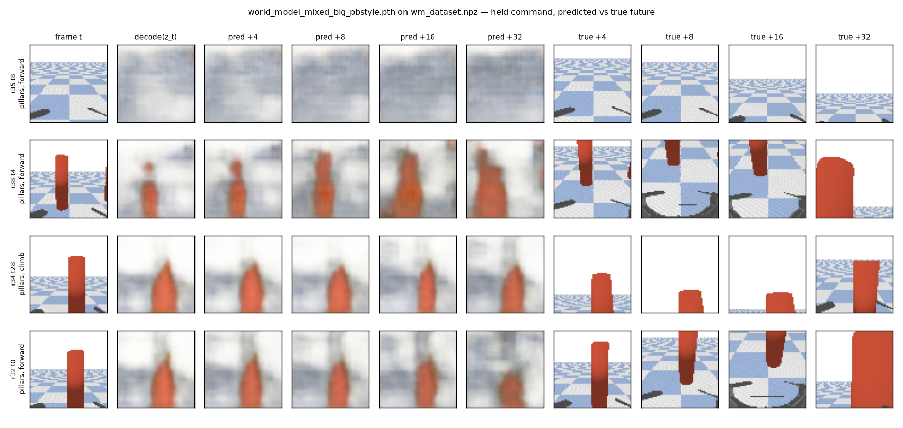

**跨域：hyperdrone pb 画风权重看 pybullet 画面 — 同一帧下六个候选指令在 +32 步的想象，以及碰撞头给出的 P(warn)/P(crit)**

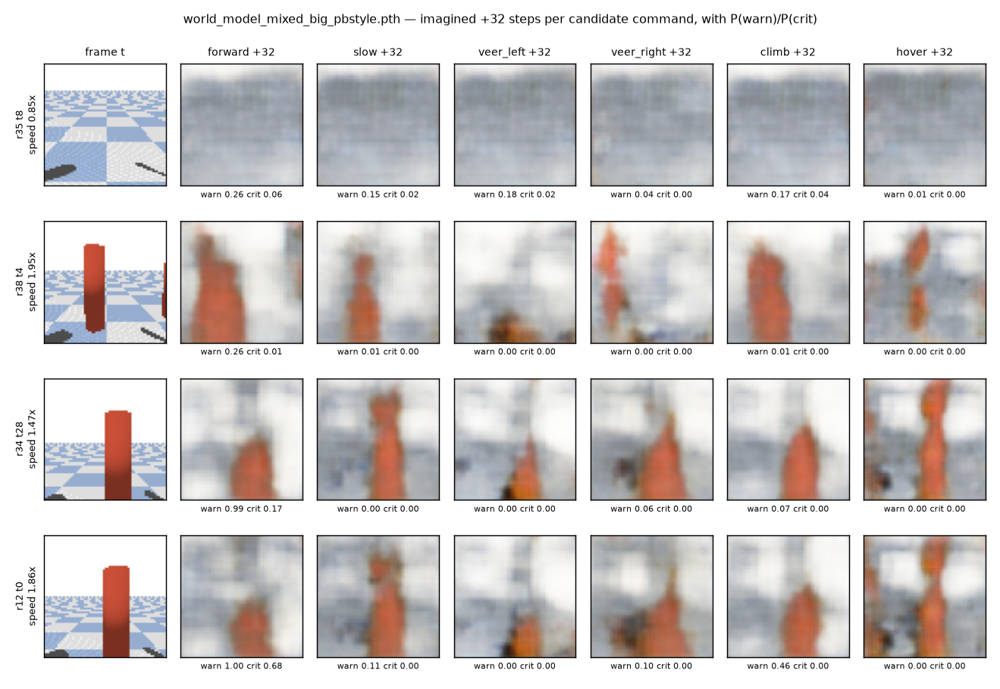


## 4. 闭环测试（次要：两个仿真器各自的柱子 course、随机外观、室内生存）

这一节回答的是"同一个策略在某个仿真器里能不能飞过去"，它既依赖世界模型，也依赖手写 MPC 的触发阈值和回中先验，而且各仿真器的画风差异主导了结果；对真机更重要的是第 3 节。

测试环境：pybullet 柱子环境（原课程的 `eval_world_model_policy.py` 300 条杂乱 course（210 条 in-path + 90 条清场）、`speed_sweep.py` 每档速度 60 条单柱子 course、`forest_demo.py` 20 片 6 行密林），以及 `src/hd_closed_loop.py` 在 hyperdrone 里镜像的同一套记分板（同 seed 同 course、同策略对象、同 12 Hz 决策、360 步、3 m 终点线、0.22 m 碰撞判定）：pybullet 画风、hyperdrone 画风，以及 hyperdrone 画风加随机外观（随机柱子粗细/高度/颜色、灯光、墙色，训练时没见过的组合）。撞击率后的 ± 是 95% Wilson 置信区间（百分点）。reactive 基线和 wm 策略共用同一 checkpoint 的编码器，所以两者都随 checkpoint 变。

### 4.0 一图看结果

每个训练结果在各测试环境里的成功率（210 条 in-path course 上没有穿越的比例，wm 策略，带 95% 置信区间）和 90 条清场 course 的误触发率；详细数字在下面的表里。

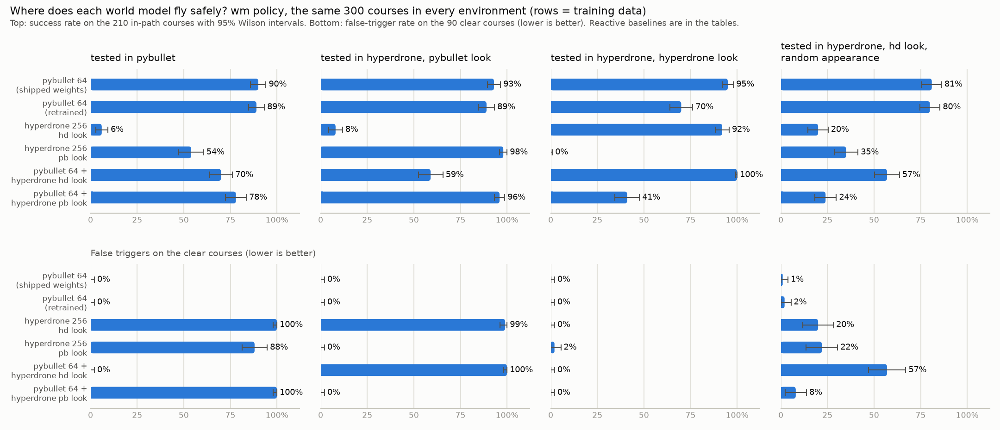

单柱子速度扫描（每档速度 60 条 course）：每个训练结果一格，三条线是三个测试环境，纵轴是 wm 策略的撞击率。

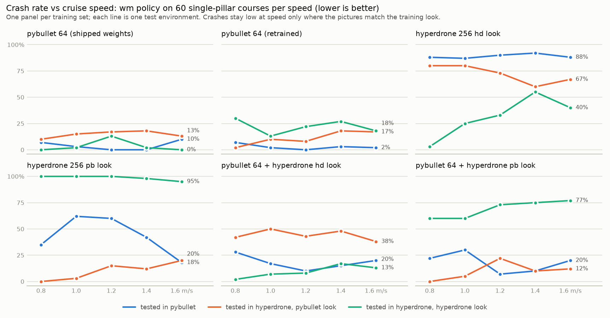

### 4.1 pybullet 环境

| checkpoint | cluttered courses: crash reactive→wm (±95% CI) | min clearance | trigger lead | false pos. (clear) | goal time | single-pillar crash wm (reactive) @0.8 / 1.2 / 1.6 m/s | forest 10×6 rows: wm crashes/forest (reactive), crash-free |
|---|---|---|---|---|---|---|---|
| `pybullet_shipped` | 0% → 10% (±4) | 0.41 → 0.41 m | +337 ms (n=210) | 0% → 0% | +3% (n=189) | 7% (0%) / 0% (5%) / 10% (63%) | 3.65 (2.20), 0% (0%) |
| `pybullet_ref` | 0% → 11% (±4) | 0.41 → 0.38 m | +335 ms (n=210) | 0% → 0% | +2% (n=186) | 7% (0%) / 0% (0%) / 2% (63%) | 2.70 (2.35), 0% (0%) |
| `mixed_big` | 100% → 94% (±3) | 0.10 → 0.11 m | -1292 ms (n=4) | 91% → 100% | – | 88% (100%) / 90% (100%) / 88% (100%) | 3.40 (2.80), 0% (0%) |
| `mixed_big_pbstyle` | 77% → 46% (±7) | 0.20 → 0.25 m | +705 ms (n=162) | 58% → 88% | +0% (n=24) | 35% (88%) / 60% (93%) / 18% (100%) | 3.60 (2.15), 0% (10%) |
| `pb_plus_big` | 1% → 30% (±6) | 0.41 → 0.35 m | +429 ms (n=210) | 2% → 0% | +6% (n=145) | 28% (0%) / 10% (5%) / 20% (68%) | 4.15 (1.60), 0% (20%) |
| `pb_plus_big_pbstyle` | 1% → 22% (±6) | 0.42 → 0.41 m | +412 ms (n=210) | 100% → 100% | +2% (n=161) | 22% (0%) / 7% (0%) / 20% (63%) | 3.50 (2.05), 0% (10%) |

### 4.2 hyperdrone 环境，pybullet 画风

| checkpoint | cluttered courses: crash reactive→wm (±95% CI) | min clearance | trigger lead | false pos. (clear) | goal time | single-pillar crash wm (reactive) @0.8 / 1.2 / 1.6 m/s |
|---|---|---|---|---|---|---|
| `pybullet_shipped@hdpb` | 0% → 7% (±4) | 0.43 → 0.51 m | +421 ms (n=210) | 0% → 0% | +7% (n=194) | 10% (0%) / 17% (2%) / 13% (20%) |
| `pybullet_ref@hdpb` | 0% → 11% (±4) | 0.43 → 0.50 m | +451 ms (n=210) | 1% → 0% | +7% (n=187) | 2% (0%) / 8% (2%) / 17% (17%) |
| `mixed_big@hdpb` | 100% → 92% (±4) | 0.12 → 0.14 m | +130 ms (n=155) | 0% → 99% | – | 80% (97%) / 73% (95%) / 67% (88%) |
| `mixed_big_pbstyle@hdpb` | 0% → 2% (±2) | 0.43 → 0.55 m | +335 ms (n=210) | 0% → 0% | +4% (n=205) | 0% (0%) / 15% (0%) / 20% (28%) |
| `pb_plus_big@hdpb` | 23% → 41% (±7) | 0.32 → 0.27 m | +529 ms (n=198) | 97% → 100% | +13% (n=103) | 42% (32%) / 43% (35%) / 38% (58%) |
| `pb_plus_big_pbstyle@hdpb` | 0% → 4% (±3) | 0.45 → 0.50 m | +335 ms (n=210) | 1% → 0% | -2% (n=201) | 0% (0%) / 22% (2%) / 12% (17%)

### 4.3 hyperdrone 环境，hyperdrone 画风

| checkpoint | cluttered courses: crash reactive→wm (±95% CI) | min clearance | trigger lead | false pos. (clear) | goal time | single-pillar crash wm (reactive) @0.8 / 1.2 / 1.6 m/s |
|---|---|---|---|---|---|---|
| `pybullet_shipped@hdhd` | 42% → 5% (±3) | 0.23 → 0.51 m | +742 ms (n=195) | 0% → 0% | +7% (n=114) | 0% (53%) / 13% (92%) / 0% (88%) |
| `pybullet_ref@hdhd` | 100% → 30% (±6) | 0.11 → 0.27 m | +872 ms (n=100) | 0% → 0% | – | 30% (100%) / 22% (100%) / 18% (90%) |
| `mixed_big@hdhd` | 0% → 8% (±4) | 0.43 → 0.43 m | +348 ms (n=210) | 0% → 0% | +9% (n=194) | 3% (0%) / 33% (0%) / 40% (27%) |
| `mixed_big_pbstyle@hdhd` | 100% → 100% (±1) | 0.10 → 0.10 m | +33 ms (n=5) | 0% → 2% | – | 100% (100%) / 100% (100%) / 95% (90%) |
| `pb_plus_big@hdhd` | 1% → 0% (±1) | 0.41 → 0.47 m | +348 ms (n=207) | 0% → 0% | +8% (n=206) | 2% (3%) / 8% (3%) / 13% (35%) |
| `pb_plus_big_pbstyle@hdhd` | 100% → 59% (±7) | 0.10 → 0.20 m | +361 ms (n=33) | 0% → 0% | +0% (n=1) | 60% (100%) / 73% (100%) / 77% (90%)

### 4.3b hyperdrone 环境，hyperdrone 画风，随机外观

柱子场景的几何不变，外观按数据生成器的随机化抽样（柱子半径 0.14–0.22 m、高度 1.0–1.8 m、颜色 ±0.3，随机太阳方向和颜色、墙色、地砖灰度）。没有任何训练集用过这些组合（`*_rand` 数据集没有参与训练）。

| checkpoint | cluttered courses: crash reactive→wm (±95% CI) | min clearance | trigger lead | false pos. (clear) | goal time | single-pillar crash wm (reactive) @0.8 / 1.2 / 1.6 m/s |
|---|---|---|---|---|---|---|
| `pybullet_shipped@hdrand` | 49% → 19% (±5) | 0.26 → 0.41 m | +448 ms (n=127) | 0% → 1% | +6% (n=83) | 28% (58%) / 15% (68%) / 5% (67%) |
| `pybullet_ref@hdrand` | 57% → 20% (±5) | 0.24 → 0.39 m | +443 ms (n=108) | 0% → 2% | +4% (n=72) | 30% (70%) / 20% (75%) / 23% (72%) |
| `mixed_big@hdrand` | 82% → 80% (±5) | 0.16 → 0.16 m | +303 ms (n=50) | 13% → 20% | +12% (n=11) | 82% (87%) / 77% (90%) / 72% (83%) |
| `mixed_big_pbstyle@hdrand` | 81% → 65% (±6) | 0.16 → 0.20 m | +354 ms (n=60) | 9% → 22% | -4% (n=13) | 75% (80%) / 77% (83%) / 73% (83%) |
| `pb_plus_big@hdrand` | 55% → 43% (±7) | 0.24 → 0.27 m | +554 ms (n=150) | 43% → 57% | -3% (n=62) | 58% (55%) / 42% (62%) / 53% (67%) |
| `pb_plus_big_pbstyle@hdrand` | 76% → 76% (±6) | 0.18 → 0.18 m | +179 ms (n=65) | 13% → 8% | +1% (n=19) | 78% (73%) / 73% (73%) / 63% (73%)

### 4.4 hyperdrone 室内环境：杂乱房间生存测试

柱子式的 course 在 ProcTHOR 房子里几乎不存在（"独立在空间中、两侧都能绕、后面还有 3 m 直路"的障碍在四栋房子各 6000 次采样里只找到 0–7 个：家具都靠墙，房间小），所以室内测试改用**生存测试**：在训练从未用过的 8 栋房子（目录 16–23）里随机取 300 个起点（净空 ≥ 0.9 m，前方 ≥ 2 m 空，随机航向），策略像在 course 上一样"无威胁就前进、有威胁就绕"，直到第一次接触障碍（距离场表面净空 + 0.18 m < 0.22 m，与柱子同一判定）或 7.5 s 到时。reactive 基线的特权绕行方向用最近障碍格的方位。两种策略用完全相同的起点。

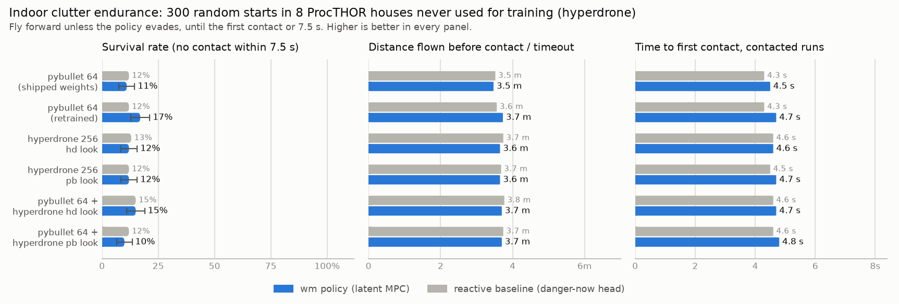

| checkpoint | 存活率 reactive→wm | 首次接触时间（接触的 run） | 平均飞行时间 | 接触前平均距离 | 平均净空 | 至少绕行一次 |
|---|---|---|---|---|---|---|
| `pybullet_shipped` | 12% → 11% | 4.3 s → 4.5 s | 4.6 s → 4.8 s | 3.52 m → 3.47 m | 1.05 m → 1.04 m | 39% → 86% |
| `pybullet_ref` | 12% → 17% | 4.3 s → 4.7 s | 4.7 s → 5.2 s | 3.56 m → 3.73 m | 1.05 m → 1.06 m | 43% → 84% |
| `mixed_big` | 13% → 12% | 4.6 s → 4.6 s | 5.0 s → 5.0 s | 3.74 m → 3.65 m | 1.02 m → 1.02 m | 59% → 76% |
| `mixed_big_pbstyle` | 12% → 12% | 4.5 s → 4.7 s | 4.9 s → 5.0 s | 3.68 m → 3.65 m | 1.02 m → 1.03 m | 59% → 77% |
| `pb_plus_big` | 15% → 15% | 4.6 s → 4.7 s | 5.0 s → 5.1 s | 3.77 m → 3.70 m | 1.02 m → 1.02 m | 62% → 83% |
| `pb_plus_big_pbstyle` | 12% → 10% | 4.6 s → 4.8 s | 5.0 s → 5.1 s | 3.74 m → 3.70 m | 1.02 m → 1.02 m | 60% → 86% |

### 4.5 一张表看跨域（210 条 in-path course 上 wm 策略的撞击率；加粗 = 该行最低且 ≤ 10%）

| 训练数据 \ 测试环境 | pybullet | hyperdrone（pb 画风） | hyperdrone（hd 画风） | hyperdrone（hd 画风，随机外观） |
|---|---|---|---|---|
| pybullet 64（仓库自带权重） | 10% | 7% | **5%** | 19% |
| pybullet 64（同脚本重训） | 11% | 11% | 30% | 20% |
| hyperdrone 256，hd 画风 | 94% | 92% | **8%** | 80% |
| hyperdrone 256，pb 画风 | 46% | **2%** | 100% | 65% |
| pybullet 64 + hd 画风 256 | 30% | 41% | **0%** | 43% |
| pybullet 64 + pb 画风 256 | 22% | **4%** | 59% | 76% |

## 5. 过程视频（seed 1001 的 in-path course；左俯视轨迹，右策略看到的 64×64 画面）

视频用的是最初的 100 条 course 评估中的一条，和放大后的评估共用同一批 seed。

**pybullet 自带权重，hyperdrone 场景 hd 画风（跨域，成功）** — [mp4](src/output/report/hd_shipped_hdlook.mp4)

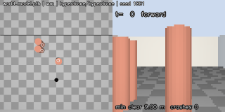

**pybullet 重训权重，hyperdrone 场景 hd 画风（跨域，失败多）** — [mp4](src/output/report/hd_ref_hdlook.mp4)


**hyperdrone 训练权重，hyperdrone 场景 hd 画风（同域）** — [mp4](src/output/report/hd_mixed_big_hdlook.mp4)

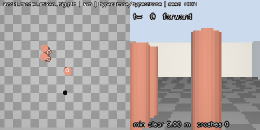

**同上，reactive 基线** — [mp4](src/output/report/hd_mixed_big_hdlook_reactive.mp4)


**pybullet + hyperdrone 合并训练，hyperdrone 场景 hd 画风** — [mp4](src/output/report/hd_pb_plus_big_hdlook.mp4)


**pybullet 自带权重，hyperdrone 场景 pb 画风** — [mp4](src/output/report/hd_shipped_pblook.mp4)

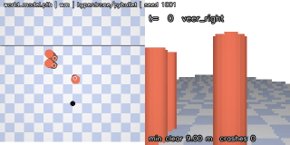

**hyperdrone pb 画风权重，hyperdrone 场景 pb 画风（同域）** — [mp4](src/output/report/hd_mixed_big_pbstyle_pblook.mp4)

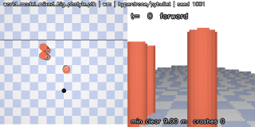

**hyperdrone hd 画风权重，hyperdrone 场景 pb 画风（画风不符，失败）** — [mp4](src/output/report/hd_mixed_big_pblook.mp4)

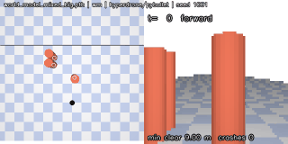


室内生存测试（17 号房子，seed 1017，同一起点；左侧是占据栅格地图：黑 = 障碍，灰 = 室外，白→灰 = 净空由大到小）：

**hyperdrone 训练权重，wm 策略** — [mp4](src/output/report/hd_room17_mixed_big.mp4)


**hyperdrone 训练权重，reactive 基线** — [mp4](src/output/report/hd_room17_mixed_big_reactive.mp4)


**pybullet 自带权重，wm 策略** — [mp4](src/output/report/hd_room17_shipped.mp4)

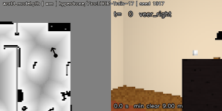

**pybullet + hyperdrone 合并权重，wm 策略** — [mp4](src/output/report/hd_room17_pb_plus_big.mp4)

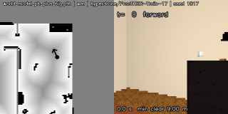


pybullet 侧的柱子森林（4 行，`forest_demo.py --rows 4`）：

**pybullet 自带权重** — [top-down mp4](src/output/report/forest_pb_shipped_wm-mpc.mp4) · [onboard mp4](src/output/report/forest_pb_shipped_wm-mpc_onboard.mp4)

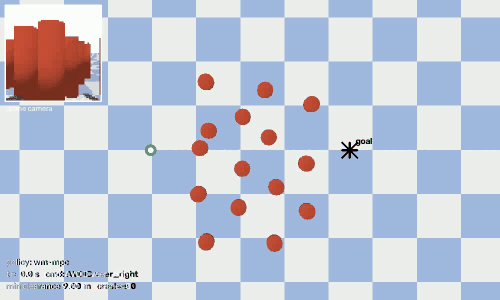

**pybullet 重训权重** — [top-down mp4](src/output/report/forest_pb_ref_wm-mpc.mp4) · [onboard mp4](src/output/report/forest_pb_ref_wm-mpc_onboard.mp4)

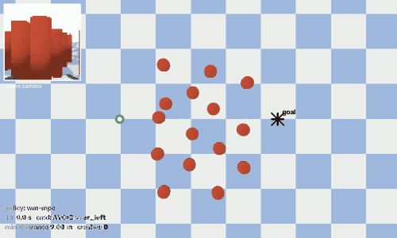

**pybullet + pb 画风合并训练** — [top-down mp4](src/output/report/forest_pb_plus_big_pbstyle_wm-mpc.mp4) · [onboard mp4](src/output/report/forest_pb_plus_big_pbstyle_wm-mpc_onboard.mp4)


**只用 hyperdrone pb 画风数据（跨域）** — [top-down mp4](src/output/report/forest_mixed_big_pbstyle_wm-mpc.mp4) · [onboard mp4](src/output/report/forest_mixed_big_pbstyle_wm-mpc_onboard.mp4)


## 6. 结论（以泛化为中心）

1. **碰撞预判的跨域泛化：pybullet 数据训出的模型最好，hyperdrone 固定配色数据训出的模型最差。** 在没有任何模型见过的随机外观柱子上，pybullet 模型的 AUC@32 仍有 0.85–0.86、安全绕行排序 0.89–0.97；hyperdrone 训练的模型 AUC 掉到 0.51–0.53（随机水平），换一种画风也只有 0.44–0.72。hyperdrone 数据集里柱子、墙、地面的配色是固定的，模型学到的是"这种橙色竖条才危险"；pybullet 自带阴影斑块和杂乱纹理的渲染在训练时起了增强作用。闭环里随机外观撞击率 19–20% 对 65–80% 和这组离线数字完全对应。
2. **合并数据把覆盖面扩到最广，但没有解决外观泛化。** pybullet + hyperdrone（hd 画风）的模型在所有柱子域 AUC ≥ 0.75、在没见过的房子里 0.68，是六个模型里"到处都还能用"的那个；但随机外观下仍只有 0.75，比 pybullet 单独训练的 0.86 还低——多加一个画风不等于学会了对画风不敏感。
3. **未来帧预测在柱子场景成立，在房间里不成立。** 柱子域上解码出的预测帧比复制当前帧好 30–60%（增益 +0.3～+0.6），柱子的位置、粗细随指令移动都看得出来；训练用过的房间只有 +0.33～+0.41，没见过的房子 ≤ 0（和复制当前帧一样甚至更差），碰撞预判也只有 0.65–0.70。64 维潜变量 + 潜空间 MSE 目标 + 128 条房间 rollout（16 栋房子）学不到房间的未来画面，只学到了"前方有大块东西就是危险"。
4. **碰撞预判 ≠ 像素预测，避障该看前者。** pybullet 模型放到 hd 画风柱子上，潜变量预测增益是 −0.06（预测器输出并不接近未来潜变量），碰撞 AUC 却有 0.93：碰撞头读的是预测器保留下来的"危险"方向，不需要整张画面都对。解码帧是诊断工具，部署指标应该是碰撞头 AUC 和绕行排序在**未见域**上的数值。
5. **对真机 Tello 的含义。** 真机 = 没见过的外观 + 房间，正是现在最弱的两个方向。证据支持的做法：(a) 生成训练数据时一定开 `--randomize`，并混入 pybullet 这类"脏"渲染或真实照片做外观增强（本报告里的 `*_rand` 数据集没有参与训练，应补一组）；(b) 房间需要远多于 128 条 rollout 和更多房子，并且潜变量目标要换成能保留场景内容的（更高维、对比式或带像素/深度辅助监督，`--save-depth` 已可用）；(c) 相机按 Tello 实测标定用 40° 稳像视角重训，部署前用真机 shadow 推理在真实房间里复测这两张热力图的指标。
6. 仓库自带的 `world_model.pth` 比同脚本重训的版本更鲁棒（hd 画风柱子上 danger-now AUC 0.73 对 0.55，闭环 5% 对 30% 撞击率），上游训练设置和脚本默认值不同，拿它当基线要留意。
7. 闭环柱子测试（第 4 节）的次要结论：画风决定迁移、动力学差异次要；pybullet → hyperdrone 几乎无损、反向只有部分迁移；合并数据在 pybullet 里变差（11% → 22–30%）是 MPC 阈值按 pybullet 模型标定的结果；室内生存率全部 10–17%，这个 MPC 没有房间导航能力，与训练数据无关。

## 7. 复现

```bash
# 数据（conda env dreamer）
python src/gen_wm_dataset_hyperdrone.py --scene mixed --rollouts 128 --rooms 128 --houses 16 --len 120 --fov-deg 60 --camera body --out src/output/wm_dataset_mixed_big_60body.npz
python src/gen_wm_dataset_hyperdrone.py --scene mixed --rollouts 128 --rooms 128 --houses 16 --len 120 --fov-deg 60 --camera body --arena-style pybullet --out src/output/wm_dataset_mixed_big_60body_pbstyle.npz
python src/merge_datasets.py src/output/wm_dataset.npz src/output/wm_dataset_mixed_big_60body.npz --out src/output/wm_dataset_pb_plus_big.npz
# 训练（GPU）
python src/train_world_model.py --epochs 80 --data src/output/wm_dataset_mixed_big_60body.npz --out src/output/world_model_mixed_big.pth
# pybullet 闭环（conda env drone_python）
python src/eval_world_model_policy.py --seeds 100 --model src/output/world_model_mixed_big.pth
python src/speed_sweep.py --seeds 30 --no-learned --model src/output/world_model_mixed_big.pth --plot src/output/speed_sweep_mixed_big.png
python src/forest_demo.py --seeds 10 --rows 6 --video none --no-learned --tag mixed_big --model src/output/world_model_mixed_big.pth
# hyperdrone 闭环（conda env dreamer）
python src/hd_closed_loop.py --model src/output/world_model_mixed_big.pth --arena-style hyperdrone
python src/hd_video.py --model src/output/world_model_mixed_big.pth --arena-style hyperdrone --seed 1001 --tag mixed_big_hdlook
# 离线泛化网格（第 3 节）
python src/eval_offline.py
# 预测解码
python src/decode_latents.py --model src/output/world_model_mixed_big.pth --data src/output/wm_dataset_mixed_big_60body.npz --tag mixed_big
```
