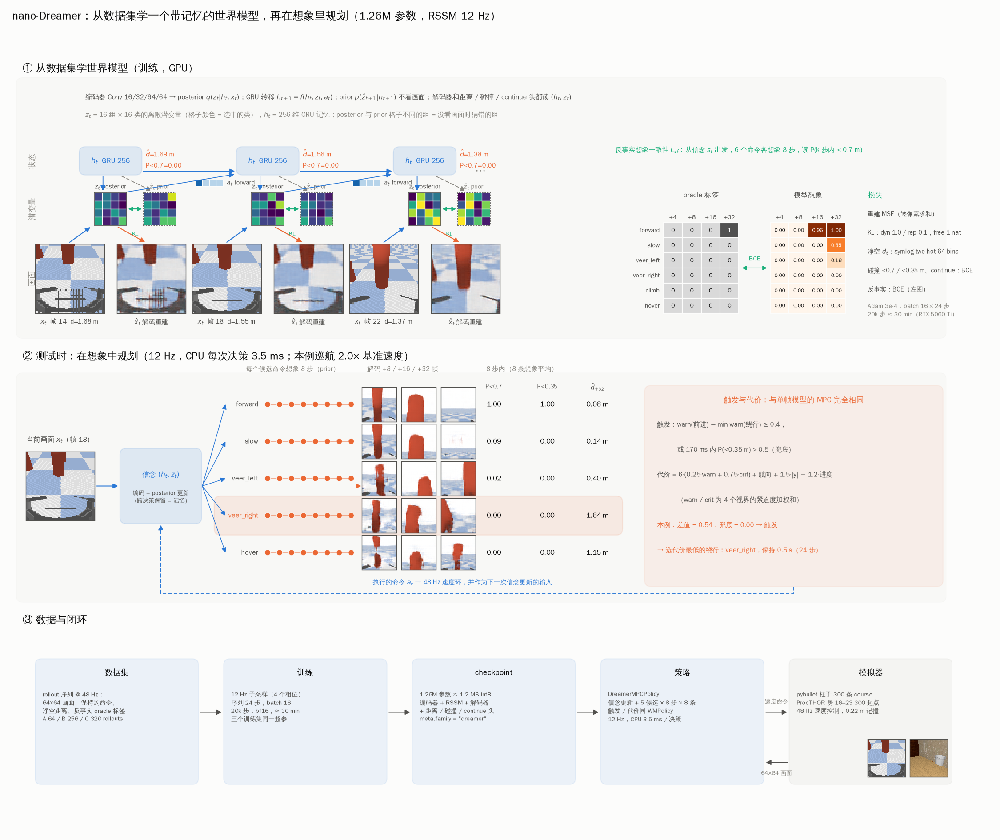
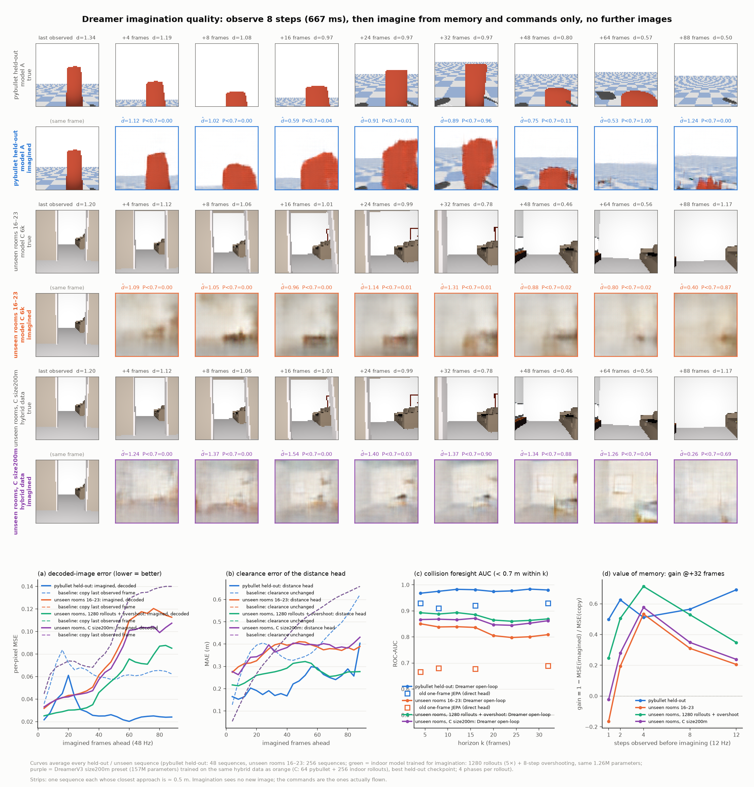
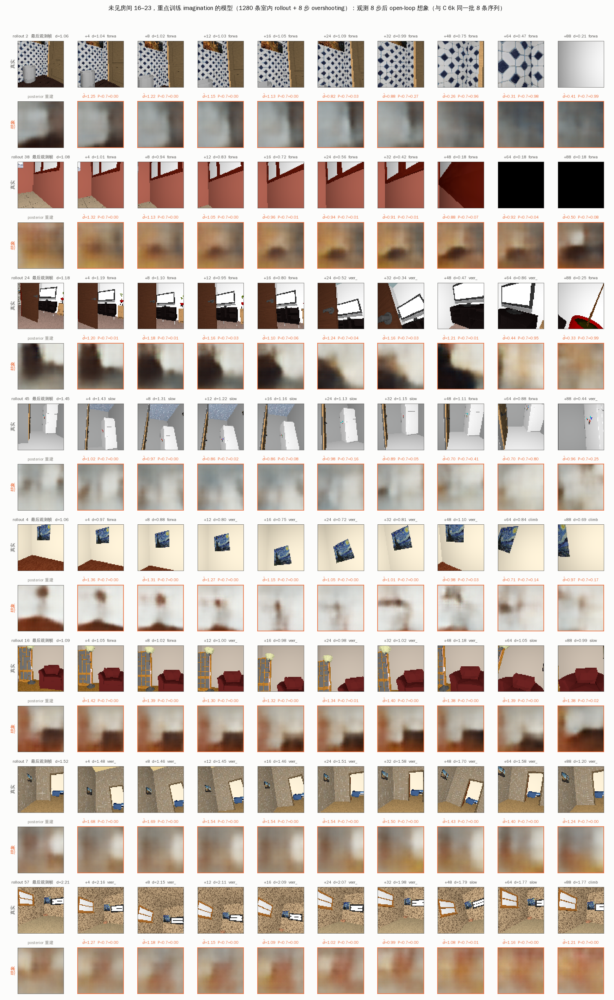
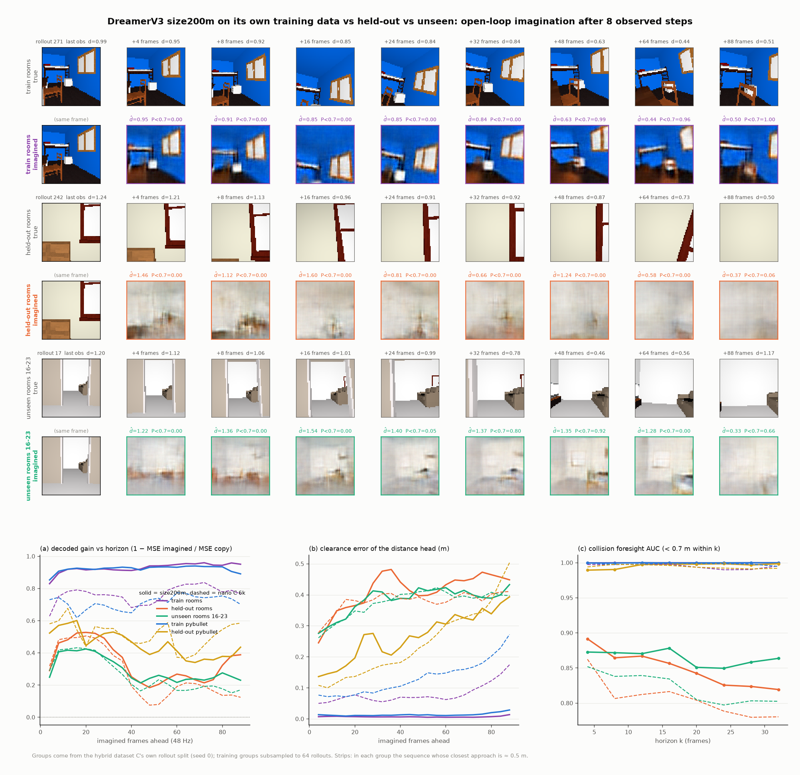
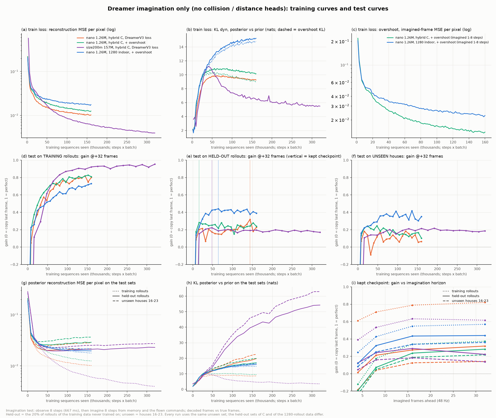
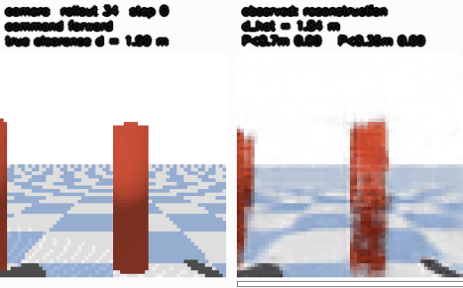
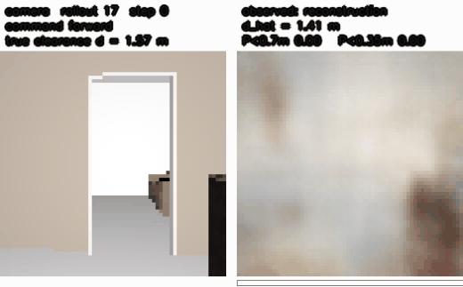
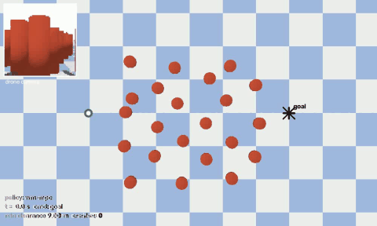
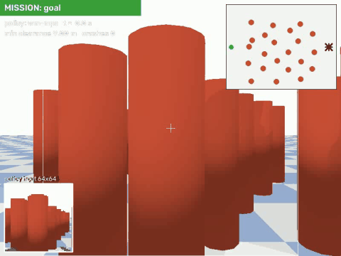
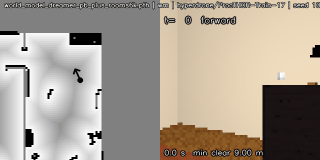

# nano-Dreamer：参考 DreamerV3 重建的无人机世界模型（首轮报告）

分支 `dreamerv3-world-model`。方案见 [PLAN_dreamerv3.md](PLAN_dreamerv3.md)，完整数表见 [dreamer_results.md](src/output/report/dreamer_results.md)，与之对照的旧模型报告见 [REPORT.md](REPORT.md)。English version: [REPORT_dreamer_en.md](REPORT_dreamer_en.md)。

**一句话结论**：把单帧的 JEPA 预测器换成 DreamerV3 风格的 RSSM 之后，世界模型本身明显变强——有记忆、能任意步想象、能把想象解码成画面，held-out 的碰撞预判 AUC@32 从 0.93 / 0.57 / 0.76 提到 0.96–0.99 / 0.81 / 0.84，未见房间从 0.69 提到 0.85–0.90；但闭环还没转化成收益：pybullet 柱子穿越率 34%（旧模型 11%），室内生存率仍是 16–19%。瓶颈在 MPC 读数的标定和室内动作菜单，不在模型。

---

## 1. 它是怎么工作的



图中所有画面、潜变量格子、概率和那次决策都是真的：数据集 rollout 2 的一个窗口（柱子在正前方，2 倍速前进）和模型 A 的实际前向。

**① 从数据集学世界模型。** 每个 12 Hz 步：64×64 画面经 4 层卷积编码，和记忆 $h_t$ 一起给出 posterior 潜变量 $z_t$（16 组 × 16 类的离散变量，格子颜色 = 选中的类）；GRU 把 $(h_t, z_t, a_t)$ 转移成 $h_{t+1}$；prior 只凭 $h_{t+1}$ 猜 $\hat z_{t+1}$，KL 把两者拉近（dyn 1.0 / rep 0.1，free 1 nat）。解码器从 $(h_t, z_t)$ 重建画面，三个头读出净空距离 $\hat d_t$（symlog two-hot）、P(< 0.7 m) / P(< 0.35 m)、continue。本项目特有的一项：从信念出发把 6 个候选命令各想象 8 步，读出的"k 步内进圈"概率要和数据集的反事实 oracle 标签一致（右侧两个网格）。

**② 测试时在想象中规划。** 每次决策（12 Hz）先用当前画面更新信念——信念跨决策保留，这就是记忆；再对菜单上的 5 个命令各想象 8 步（= +32 帧），每条想象 8 次取平均，读出 8 步内的 P(< 0.7) / P(< 0.35) 和 $\hat d$；触发条件和代价与旧模型的 `WMPolicy` 完全相同（相对触发 ≥ 0.4、170 ms 兜底、代价 = 6·危险 + 航向 + 1.5·|y| − 1.2·进度），所以和 A/B/C 的比较只比世界模型。图里这次决策：前进的 8 步内 P(< 0.7) = 1.00，右偏 0.00，差值 0.54 → 触发，选 veer_right 保持 0.5 s。想象解码的画面（+8 / +16 / +32 帧）能看到：前进 = 柱子撑满再穿过去，右偏 = 柱子向左滑出视野。

**③ 闭环。** 数据集 48 Hz 序列 → GPU 训练 20k 步（约 30 min）→ 1.26M 参数 checkpoint → 策略在 CPU 上每次决策 3.5 ms → 模拟器 48 Hz 速度控制（pybullet 柱子 300 条 course；ProcTHOR 未见房间 300 个起点）。

## 2. 模型与训练细节

| 项 | 值 |
|---|---|
| 编码器 | Conv k4 s2 ×4，通道 16/32/64/64，LayerNorm + SiLU，输出 1024 维 |
| RSSM | deter 256（LayerNorm-GRU），stoch 16 组 × 16 类，hidden 128，unimix 1%，straight-through 采样 |
| 解码器 | Linear 512→4×4×32，反卷积 ×4 → 64×64×3 |
| 头 | 净空：MLP 512→128→128→64 bins（symlog 0–4 m）；碰撞 2 logits；continue 1 logit |
| 参数量 | 1.26M（编码器 0.11M，RSSM 0.59M，解码器 0.34M，头 0.22M）≈ 1.2 MB int8 |
| 时间尺度 | 数据 48 Hz，模型每步 4 帧（12 Hz），4 个相位当增广；想象 8 步 = 667 ms，对应旧模型的 +32 |
| 损失 | 重建 MSE（逐像素求和）+ 净空 two-hot + 碰撞/continue BCE + KL dyn 1.0 + KL rep 0.1 + 反事实 BCE 1.0 |
| 优化 | Adam 3e-4，eps 1e-8，warmup 1k，梯度范数裁剪 100，bf16，batch 16 × 24 步，20k 步 |
| 切分 | 按 rollout 80/20，按 in_path × passive 分层（与旧模型相同），所有指标在 held-out rollouts 上 |
| 数据 | A 纯 pybullet 64 rollouts（7,680 帧）；B 纯室内 256（30,720）；C 合并 320（38,400）；三者同一超参 |
| 代码 | `src/dreamer/{nets,rssm,data}.py`，`src/train_dreamer.py`，`src/dreamer_policy.py`，`src/draw_dreamer_pipeline.py`，`src/dreamer_dream_video.py`，`src/dreamer_summary.py` |

**和 DreamerV3 的尺寸对比**：不是同一尺寸。本模型介于 DreamerV3 最小的两个预设之间（数值来自 `dreamerv3/configs.yaml`，DreamerV3 的 stoch 组数固定为 32）：

| 模型 | deter | hidden | stoch × classes | CNN depth | MLP units | 参数量 |
|---|---|---|---|---|---|---|
| DreamerV3 size1m | 512 | 64 | 32 × 4 | 4 | 64 | ≈ 1M |
| **本项目 nano** | 256 | 128 | 16 × 16 | 16 | 128 | **1.26M** |
| 本项目 wide | 512 | 256 | 32 × 32 | 32 | 256 | 6.33M |
| DreamerV3 size12m | 2048 | 256 | 32 × 16 | 16 | 256 | ≈ 12M |
| DreamerV3 size50m | 4096 | 512 | 32 × 32 | 32 | 512 | ≈ 50M |
| DreamerV3 size200m（默认） | 8192 | 1024 | 32 × 64 | 64 | 1024 | ≈ 200M |

未移植的部分：block-diagonal GRU（`blocks: 8`）、LaProp/AGC 优化器（这里用 Adam + 梯度范数裁剪）。

与 DreamerV3 原样一致的部分：RSSM 结构、离散潜变量 + unimix、KL balancing + free bits、symlog / two-hot、LayerNorm + SiLU、重建 + 奖励型头。改动：纯离线数据集（无 replay / 交互）；reward 头换成净空与碰撞头；新增反事实想象一致性；actor-critic（B2）尚未做，规划用想象 MPC（B1）。

## 3. 结果

### 3.1 训练集内 held-out

旧模型的 AUC 是单帧直接读头；Dreamer 的是 **open-loop**：观测 667 ms 后在飞过的命令下纯想象 8 步再读头（设定更难）。解码增益 = 1 − MSE(预测帧, 真帧) / MSE(当前帧, 真帧)。

| 训练集 | 模型 | AUC@32 | 解码增益 @8 / @32 | 想象 @32 的净空 MAE | veer ranking |
|---|---|---|---|---|---|
| A | JEPA 单帧（83k） | 0.93 | ≈ +0.4 @32（事后拟合解码器） | — | 1.00 (n=45) |
| A | nano-Dreamer 20k 步 | **0.96** | +0.29 / +0.53 | 0.27 m | 0.95 (n=19) |
| A | nano-Dreamer，反事实不做视野 mask，8k 步 | **0.99** | +0.33 / +0.56 | 0.27 m | 0.89 (n=19) |
| B | JEPA 单帧 | 0.57 | ≤ 0 | — | nan (n=0) |
| B | nano-Dreamer 20k 步 | **0.76** | +0.03 / +0.05 | 0.46 m | 0.45 (n=76) |
| B | nano-Dreamer 6k 步早停 | **0.81** | +0.16 / +0.18 | 0.41 m | 0.46 (n=76) |
| C | JEPA 单帧 | 0.76 | — | — | 0.87 (n=45) |
| C | nano-Dreamer 20k 步 | **0.84** | +0.11 / +0.18 | 0.38 m | 0.78 (n=78) |
| C | nano-Dreamer 6k 步早停 | **0.83** | +0.18 / +0.14 | 0.40 m | 0.82 (n=78) |

训练曲线：A 在 4k 步就到平台（0.99 / +0.55），之后不变；B 在 4k 步最好（0.81 / +0.17），到 16k 步退到 0.74 / +0.06——室内 256 条 rollout 被 20k 步过拟合，所以补了 6k 步早停版。

### 3.2 离线泛化（held-out 帧，\* = 训练时见过的数据域）

碰撞预判 AUC@32：

| 训练集 | 模型 | pybullet 柱子 | hyperdrone 柱子·随机外观（未见） | 室内房 0–15 | 室内房 16–23（未见） |
|---|---|---|---|---|---|
| A | JEPA 单帧 | 0.95\* | 0.85 | 0.51 | 0.46 |
| A | nano-Dreamer | 1.00\* | 0.73 | 0.64 | 0.75 |
| A | nano-Dreamer，不做视野 mask | 1.00\* | 0.81 | 0.68 | 0.72 |
| B | JEPA 单帧 | 0.44 | 0.57 | 0.76\* | 0.69 |
| B | nano-Dreamer | 0.59 | 0.76 | 0.84\* | **0.90** |
| B | nano-Dreamer 6k | 0.64 | 0.83 | 0.91\* | 0.89 |
| C | JEPA 单帧 | 0.96\* | 0.81 | 0.77\* | 0.69 |
| C | nano-Dreamer | 1.00\* | 0.71 | 0.85\* | 0.85 |
| C | nano-Dreamer 6k | 0.99\* | **0.83** | 0.83\* | 0.85 |

解码未来帧增益 @32（0 = 不比复制当前帧好）：

| 训练集 | 模型 | pybullet 柱子 | 随机外观柱子 | 室内房 0–15 | 室内房 16–23（未见） |
|---|---|---|---|---|---|
| A | JEPA 单帧 | +0.64\* | +0.33 | −0.58 | −0.54 |
| A | nano-Dreamer | +0.91\* | −0.74 | −2.64 | −1.44 |
| B | JEPA 单帧 | +0.28 | +0.27 | +0.12\* | −0.06 |
| B | nano-Dreamer | −2.55 | −0.24 | +0.16\* | **+0.10** |
| C | JEPA 单帧 | +0.57\* | +0.37 | +0.10\* | +0.04 |
| C | nano-Dreamer | +0.85\* | −0.13 | +0.07\* | **+0.25** |
| C | nano-Dreamer 6k | +0.74\* | −0.01 | +0.20\* | +0.15 |

读法：室内训练的 Dreamer 在**从没见过的房子**里，碰撞预判 0.85–0.90，解码的未来帧第一次比"复制当前帧"好（旧模型全部 ≤ 0）。代价是重建损失把潜变量绑在外观上：A 在随机外观柱子上从 0.85 退到 0.73（去掉视野 mask 的版本 0.81，早停的 C6k 0.83），在域外的解码增益是大负数——它在认真地画错的东西。

### 3.3 闭环

| 训练集 | 模型 | pybullet 穿越率（wm） | 触发提前量 | 室内生存率（wm） | 室内，菜单含 hover |
|---|---|---|---|---|---|
| A | JEPA 单帧 | **11%** | +335 ms | 17% | 23% |
| A | nano-Dreamer，首版读数 | 41% | +225 ms | 17% | 17% |
| A | nano-Dreamer，8 条想象平均 + 只看未来 | 34% | +234 ms | 17% | 17% |
| A | nano-Dreamer，不做视野 mask | 34% | +292 ms | 未跑 | 未跑 |
| B | JEPA 单帧 | 82% | — | 16% | 19% |
| B | nano-Dreamer / 6k | 82% / 未跑 | — | 17% / 12% | 16% / 14% |
| C | JEPA 单帧 | 20% | — | 16% | 19% |
| C | nano-Dreamer / 6k | 20% / 27% | — | 15% / 19% | 16% / 18% |

参考：室内同菜单的特权 oracle 生存率 32%，允许悬停 89%。"菜单含 hover"= 两个绕行方向在 170 ms 内 P(< 0.35 m) 都超过 0.5 时悬停 0.5 s，新旧模型同一规则。决策延迟：Dreamer 3.5 ms / 决策（CPU），旧模型 0.1 ms。

### 3.4 想象质量评价



`src/eval_imagination.py`。观测 8 步（667 ms）后不再看画面，纯凭记忆和实际飞过的命令向前想象到 +88 帧；曲线是所有 held-out / 未见序列的平均（pybullet 48 条，未见房间 256 条）。

- **(a) 解码画面**：pybullet 上想象解码的逐像素 MSE 全程 0.02–0.03，"复制最后观测帧"是 0.06–0.08，差 3 倍，且 88 帧后没有发散；未见房间 +32 帧时 0.047 对 0.069，到 +88 帧退回到和复制差不多（0.12 对 0.14）——想象在陌生房间里撑得住约 1 s。
- **(b) 净空距离**：pybullet 上 dist 头想象 +32 帧的误差 0.16 m（"净空不变"基线 0.37 m），+88 帧 0.28 m 对 0.6 m；未见房间 0.3–0.4 m，和基线持平，说明陌生房间里它知道"会不会撞"但说不准"离多远"。
- **(c) 碰撞预判**：open-loop 想象的 AUC 在 pybullet 上 0.97–0.98（旧单帧模型 0.91–0.93），未见房间 0.81–0.85（旧模型 0.67–0.69），且基本不随视界衰减。
- **(d) 记忆的价值**：先观测 1 步就想象时，未见房间的增益是 −0.15（比复制还差），观测 4 步后 +0.54；pybullet 从 0.50 升到 0.69。观测超过 4 步后未见房间的增益回落，一部分原因是起点越靠后、目标帧离家具越近、越难预测，不全是记忆的锅。

上面的画面条：pybullet 一条 held-out 序列，想象能画出柱子逼近、撑满、从侧面滑走；未见房间只有墙、地面和一团家具色块，但 $\hat d$ 和 P(< 0.7) 的走势跟着真值走。

### 3.5 重点训练 imagination（室内）

**为什么室内想象比 DreamerV3 差那么多。** 和原版 [danijar/dreamerv3](https://github.com/danijar/dreamerv3) 相比，按影响排序：

1. **数据量**：DreamerV3 在线交互，replay 里几百万帧，且在同一个环境里评测；我们室内只有 256 条 rollout（16 间房，30,720 帧），离线固定，4k 步后 held-out 就开始退化（[loss 曲线](src/output/report/dreamer_losses.png)）。
2. **训练目标只有一步**：DreamerV3 只用单步 posterior / prior KL；室内 KL 停在 8–11 nats，说明 prior 预测不了 posterior，多步想象时误差累积。
3. **模型容量**：DreamerV3 最小预设 size12m（deter 2048），我们 1.26M。但实验表明这不是主因（见下表 wide）。
4. **其它**：观测只有图像（没喂姿态，而机体俯仰最高 30° 会带着相机转）；rollout 只有 2.5 s，命令每 1 s 换一次。

**做了什么。** 新增 `--overshoot K`（PlaNet 式 latent / pixel overshooting，DreamerV3 没有）：从随机 posterior 状态用 prior 想象 K = 8 步，要求想象状态解码出真实未来帧、KL 对齐到那一步的 posterior、读出真实净空和碰撞标签，直接优化 open-loop 评测量。另外用同样 16 间训练房、新 seed 再生成 1024 条 rollout，合并成 1280 条（`wm_dataset_rooms_train60_1280.npz`）。

| 室内模型（held-out 训练房，open-loop） | 参数 | AUC@32 | 解码增益 @8 / @32 | 想象 +32 帧净空误差 |
|---|---|---|---|---|
| B，256 条，20k 步 | 1.26M | 0.76 | +0.03 / +0.05 | 0.46 m |
| B，256 条，6k 步早停 | 1.26M | 0.81 | +0.16 / +0.18 | 0.41 m |
| wide，256 条，8k 步 | 6.33M | 0.75 | +0.09 / +0.10 | 0.46 m |
| wide + 外观增广，256 条 | 6.33M | 0.76 | −0.13 / −0.07 | 0.49 m |
| wide + overshoot，256 条，6k 步 | 6.33M | 0.76 | +0.14 / +0.13 | 0.46 m |
| **nano + overshoot，1280 条，12k 步** | 1.26M | **0.87** | **+0.30 / +0.39** | **0.32 m** |

在**未见房间 16–23** 上（256 条序列，`eval_imagination.py`，即 3.4 节图里的绿线）：

| 未见房间 | 旧 C 6k | 1280 条 + overshoot |
|---|---|---|
| open-loop AUC @4 / @32 | 0.85 / 0.81 | **0.89 / 0.87** |
| 解码 MSE @+32 帧（复制基线 0.069） | 0.048 | **0.033** |
| 解码 MSE @+88 帧（复制基线 0.140） | 0.121 | **0.085** |
| 净空误差 @+32 帧（"不变"基线 0.37 m） | 0.39 m | **0.27 m** |
| 解码增益@+32，观测 1 / 4 步后 | −0.19 / +0.53 | **+0.25 / +0.71** |

结论：**瓶颈是数据和训练目标，不是容量**——加宽到 6.3M 没用，加外观增广反而更差；5 倍数据 + overshooting 让未见房间的想象第一次全程优于"复制当前帧"，净空估计也第一次优于"不变"基线。



上图与 [旧模型 C 6k 的同一批 8 条序列](src/output/report/imagination_examples_rooms_unseen_C6k.png) 对照（另有 [它自己 1280 条训练数据中 held-out rollout 的例子](src/output/report/imagination_examples_rooms_heldout_1280os.png)）。想象仍然是糊的——墙、地面、大件家具的色块和位置对得上，纹理和小物体画不出来；但随前进画面变暗、接近墙面时 P(< 0.7) 升起来的时机和真实净空一致。要达到 DreamerV3 那种清晰度，下一步是继续加数据（更多房子而不只是同一批房子更多 seed）、把姿态作为观测输入，再考虑放大模型。

**DreamerV3 size200m，只在 hybrid 数据上训练。** 用和模型 C 相同的 hybrid 数据（64 条 pybullet + 256 条室内），训练 DreamerV3 的 size200m 预设：deter 8192、32 × 64 潜变量、CNN depth 64（mults [2, 3, 4, 4]）、MLP units 1024、8 块的 block-diagonal GRU、255 个 two-hot bins。因为不含 actor / critic，这里是 157M 参数。训练设置：batch 32 × 24 步（16 GB 显卡能放下的最大 batch；batch 64 会溢出到系统内存，慢 14 倍）、Adam 1e-4、10k 步、每步 0.39 s（约 70 分钟），每 1k 步做 held-out 评估，保留最好的 checkpoint（第 5000 步）。即 3.4 节图中紫色的画面条和曲线；同一批 8 条未见房间序列的例子图见 [size200m](src/output/report/imagination_examples_rooms_unseen_size200m.png)（对照 [nano C 6k](src/output/report/imagination_examples_rooms_unseen_C6k.png)），训练数据自身 held-out rollout 的例子见 [这里](src/output/report/imagination_examples_rooms_heldout_size200m.png)，训练曲线（紫色）见 [loss 图](src/output/report/dreamer_losses.png)。

| hybrid 数据（C） | nano 6k（1.26M） | size200m（157M） | nano，1280 条室内 + overshoot（参照） |
|---|---|---|---|
| C 的 held-out：open-loop AUC@32 | 0.83 | **0.87** | — |
| C 的 held-out：解码增益 @8 / @32 | +0.18 / +0.14 | +0.19 / **+0.25** | — |
| C 的 held-out：veer ranking | 0.82 | **0.85** | — |
| 未见房间：open-loop AUC @4 / @32 | 0.85 / 0.81 | 0.87 / 0.86 | **0.89 / 0.87** |
| 未见房间：解码 MSE @+32 帧（复制 0.069） | 0.047 | 0.046 | **0.032** |
| 未见房间：解码 MSE @+88 帧（复制 0.140） | 0.113 | 0.107 | **0.085** |
| 未见房间：净空误差 @+32 帧（基线 0.37 m） | 0.40 m | 0.36 m | **0.28 m** |
| 未见房间：观测 1 / 4 步后的增益 @+32 | −0.16 / +0.53 | −0.02 / +0.58 | **+0.25 / +0.71** |

读法：在同样 320 条数据上把参数放大 125 倍，有小而一致的提升：未见房间的碰撞预判 AUC 高 0.05，held-out 解码增益 @32 从 0.14 升到 0.25。想象画面的纹理也更锐利，画面条里能画出窗框和边缘；但它也会编出真实画面里没有的窗户，在未见房间的解码误差上几乎没赢 nano。用 5 倍室内数据加 overshooting 的 nano 模型，在所有未见房间指标上仍明显领先。held-out 指标在第 5000 步最好，之后下降，而训练重建损失还在降，说明大模型在 320 条数据上过拟合。这印证了上面的结论：**在这个数据量下，更多数据和多步训练目标比 DreamerV3 级别的容量更有用。**

**训练集 vs held-out vs 未见（检查是否在背数据）。** `src/eval_train_gap.py` 对两个 hybrid 数据模型，在它们训练用过的 rollout、C 的 held-out rollout 和未见房间上，做同样的 open-loop 想象打分（[图](src/output/report/train_gap.png)）。



| 组（C 数据的切分） | size200m 增益 @32 / @88 | size200m 净空误差 @32 | size200m AUC@32 | nano C 6k 增益 @32 / @88 | nano 净空误差 @32 | nano AUC@32 |
|---|---|---|---|---|---|---|
| 训练集·室内 | **+0.92 / +0.95** | **0.01 m** | 1.00 | +0.77 / +0.77 | 0.06 m | 0.99 |
| held-out·室内 | +0.42 / +0.38 | 0.46 m | 0.82 | +0.37 / +0.10 | 0.41 m | 0.79 |
| 未见房间 16–23 | +0.35 / +0.26 | 0.38 m | 0.86 | +0.31 / +0.21 | 0.38 m | 0.81 |
| 训练集·pybullet | **+0.93 / +0.89** | **0.01 m** | 1.00 | +0.72 / +0.74 | 0.09 m | 1.00 |
| held-out·pybullet | +0.53 / +0.44 | 0.24 m | 1.00 | +0.59 / +0.58 | 0.16 m | 0.99 |

基线："复制最后一帧"的增益为 0；"净空不变"的误差 0.35–0.43 m。

在自己的训练 rollout 上，size200m 几乎完美：不看新画面往前想象 88 帧（1.8 s），解码画面里蓝墙、上下铺、椅子和窗户的位置都对（图中第一行），净空误差 1 cm，解码误差比复制基线低 8–12 倍。换到同一批房子的 held-out rollout，增益掉到 +0.42，净空误差 0.46 m，不比"净空不变"好；画面条里是一间模糊、部分编造的房间。size200m 的训练 / held-out 差距是解码增益约 0.5、净空误差约 0.45 m，nano 是约 0.4 和 0.35 m。**大模型把 320 条训练 rollout 背下来了**；能泛化的部分（held-out 和未见房间）只比 nano 略好，在 held-out pybullet 上甚至更差。限制它的不是容量，而是数据。

**例子大图：训练集 vs held-out vs 未见。** 每张图 8 条室内序列（上行真实画面，下行观测 8 步后的 open-loop 想象），按最近净空从很近到很远均匀抽取。"训练集" = 模型训练时用过的 rollout；"held-out" = 同一批房子里留出、不参与训练的 20% rollout（与训练用的切分相同，seed 0）；"未见" = 房 16–23，从没用过。nano C 6k 和 size200m 用同一份训练数据，所以它们的训练集和 held-out 图是同一批 rollout；所有未见房间图是同一批 8 条序列。

| 模型 | 训练集 rollout（见过） | held-out rollout（同一批房子，没见过的飞行） | 未见房间 16–23 |
|---|---|---|---|
| nano C 6k (1.26M, hybrid C) | [训练集](src/output/report/imagination_examples_train_rooms_pb_plus_rooms6k.png) | [held-out](src/output/report/imagination_examples_heldout_rooms_pb_plus_rooms6k.png) | [未见房间](src/output/report/imagination_examples_unseen_rooms_pb_plus_rooms6k.png) |
| size200m (157M, hybrid C) | [训练集](src/output/report/imagination_examples_train_rooms_pb_plus_rooms_size200m.png) | [held-out](src/output/report/imagination_examples_heldout_rooms_pb_plus_rooms_size200m.png) | [未见房间](src/output/report/imagination_examples_unseen_rooms_pb_plus_rooms_size200m.png) |
| nano, 1280 indoor + overshoot | [训练集](src/output/report/imagination_examples_train_rooms_rooms1280_os.png) | [held-out](src/output/report/imagination_examples_heldout_rooms_rooms1280_os.png) | [未见房间](src/output/report/imagination_examples_unseen_rooms_rooms1280_os.png) |

看点：在训练集图上，size200m 能把椅子、门、冰箱，甚至撞墙后画面变黑都想象出来；到了 held-out 和未见房间，同一个模型只剩墙、地面和大色块。

### 3.6 只看 imagination（不含碰撞 / 距离头）

为了单独分析想象能力，用 `--imag-only` 训练了四个世界模型：只有重建 + KL（dyn 1.0 / rep 0.1，free 1 nat），也就是不带 reward / continue 头的 DreamerV3 世界模型目标；其中两个加了 8 步 overshooting。每 500 步在三个测试集上做同样的 open-loop 想象测试（观测 8 步、再凭记忆和实际命令想象 8 步、解码）：64 条**训练集** rollout、**held-out** rollout、64 条**未见房间** 16–23 的 rollout，并保留 held-out 最好的 checkpoint。脚本：`src/plot_imagination_curves.py`。



看法：第一行是训练损失（在训练 batch 上算），第二行是同一个想象测试在三个测试集上随训练的变化，第三行是测试集上的 posterior 重建误差和 posterior–prior KL，以及保留 checkpoint 在不同想象距离下的增益（点线 = 训练集 rollout，实线 = held-out，虚线 = 未见房间）。横轴是已训练的序列数（步数 × batch），因为 size200m 用的是 batch 32。

保留 checkpoint 的 +32 帧解码增益（1 − 想象误差 / 复制最后一帧的误差）和 KL（nats）：

| 实验 | 保留步数 | 训练集 rollout | held-out rollout | 未见房间 | KL 训练 / held-out / 未见 |
|---|---|---|---|---|---|
| nano，hybrid C，DreamerV3 损失 | 9000 | +0.82 | +0.32 | +0.14 | 8.5 / 18.5 / 21.6 |
| nano，hybrid C，+ overshoot | 1000 | +0.37 | +0.28 | +0.22 | 7.6 / 7.7 / 7.6 |
| size200m，hybrid C，DreamerV3 损失 | 1500 | +0.62 | +0.22 | +0.14 | 9.5 / 13.8 / 15.1 |
| **nano，1280 条室内，+ overshoot** | 4000 | +0.57 | **+0.44** | **+0.36** | 12.8 / 12.8 / 13.0 |

训练到第 10000 步时，size200m 在训练集上达到 +0.95，但 held-out 只有 +0.17、未见房间 +0.19，KL 分别是 3.5 / 54 / 63 nats。

结论：

1. **在训练集 rollout 上，想象会变得几乎完美，模型越大越明显**（图 d：size200m 0.95，nano 约 0.8）。这只衡量记忆。
2. **在 held-out 和未见数据上，用 hybrid 数据时无论模型大小都停在 +0.2–0.3**（图 e、f）。size200m 在这里不比 nano 好，它在第 1500 步就到了 held-out 最好，之后只会下降。
3. **KL 图（h）最能看出过拟合。** 在训练集上，prior 对 posterior 的预测越来越准（size200m 降到 3.5 nats）；在 held-out 和未见数据上，KL 一直在涨（size200m 54–63 nats，nano 18–22）。模型对背过的飞行越来越有把握，对新飞行越来越"吃惊"。
4. **单加 overshoot 解决不了**（绿色）：在 320 条的 hybrid 数据上，它的 held-out 曲线平在 0.25 左右，保留的是最早的 checkpoint。
5. **真正让测试曲线上升的是数据量**（蓝色）：用 1280 条室内 rollout，训练 / held-out / 未见三组的 KL 几乎一样（12.8 / 12.8 / 13.0），held-out 增益 +0.44、未见房间 +0.36，是所有实验里最高的；而它在训练集上的增益反而最低。点线和实线之间的差距小，就是"能泛化的想象"的样子。
6. **最短的想象距离反而最差**（图 i）：+4 帧时在新数据上的增益接近或低于 0。原因是 83 ms 内"复制最后一帧"本身就是很强的基线，而解码会把细节画糊；想象距离越长，真实画面离最后一帧越远，增益就越大。

结论：用 Dreamer 的结构，在新飞行上的想象能力受限于数据的数量和多样性，而不是模型大小或训练目标。要继续提升想象，下一步是更多房子、更长的 rollout，并用 held-out 早停。

## 4. 演示视频

**4.1 "梦"：真实画面 vs 模型想象。** 左边是相机真实看到的画面（12 Hz），右边前 8 步是 posterior 重建，之后模型**不再看任何画面**，只凭记忆和飞过的命令向前想象，每一帧都是想象状态解码出来的；蓝字是想象状态读出的净空距离和 P(< 0.7 m)。

pybullet，held-out rollouts，模型 A — [mp4](src/output/report/dream_pybullet.mp4)



未见房间（房 16–23），模型 C 6k — [mp4](src/output/report/dream_rooms_unseen.mp4)



pybullet 里柱子逼近、擦过、地面回来都能想出来，净空估计跟得上真值；未见房间里只剩墙和地面的色块，家具画不出来，但 P(< 0.7) 的走势仍然对——这正对应 3.2 节"碰撞预判比像素预测更能迁移"。

**4.2 想象规划飞柱子森林**（pybullet，模型 A，比训练 course 更密更长）— [俯视 mp4](src/output/report/forest_dreamer_pb_wm-mpc.mp4) · [机载 mp4](src/output/report/forest_dreamer_pb_wm-mpc_onboard.mp4)





这一趟到达终点，但擦撞 3 次、最小净空 0.04 m，和 3.3 节的 34% 穿越率是同一个问题。

**4.3 未见房间续航**（ProcTHOR 房 17，模型 C 6k，左俯视、右机载）— [mp4](src/output/report/hd_room17_dreamer.mp4)



飞了 4.6 s 后接触，最小净空 0.21 m：绕行只有左右两个方向，被家具夹住时没有退路。

**4.4 open-loop 想象的解码帧（静态）**：[A pybullet](src/output/report/dreamer_openloop_pybullet.png) · [B 室内](src/output/report/dreamer_openloop_rooms.png) · [C 合并](src/output/report/dreamer_openloop_pb_plus_rooms.png)。

## 5. 为什么闭环没赢，下一步做什么

1. **MPC 读数噪声**。单次采样的想象在同一条 course 上换个随机流就从撞变成不撞；改成 8 条平均后 41% → 34%。
2. **"k 步内"饱和**。训练目标里"k 步内进圈"包含当前状态，一进 0.7 m 环所有候选都读 1.0，差值归零，只剩对中先验在挑方向，trace 里撞的 course 就是这样撞进柱心的。已改成只比较未来步，但绕行候选的 crit 预测仍偏低，触发比旧模型晚约 100 ms。
3. **反事实 mask**。沿用了单帧模型"威胁不在视野内就不监督"的 mask，等于告诉有记忆的模型不必记住视野外的柱子；去掉后 held-out 更好（0.99、随机外观 0.81），闭环持平 34%。
4. **室内上限是菜单**。同菜单 oracle 也只有 32%；含 hover 规则对 Dreamer 几乎不触发，因为它对绕行的 crit 预测偏低。
5. **过拟合**。B 在 4k 步最好，20k 步明显退化。

下一步（按收益排序）：(a) MPC 代价改成直接比较想象出的净空距离（dist 头）而不是阈值概率，含 hover 也用净空判断；(b) 用 held-out 早停和 `--robust` 增广重训三个模型；(c) 把三个闭环阈值按 Dreamer 重新标定或改成 critic 式代价；(d) 之后再做 B2 的梦中 actor-critic。

## 6. 复现

```bash
python src/train_dreamer.py --data src/output/wm_dataset.npz --out src/output/world_model_dreamer_pybullet.pth --tag pybullet --steps 20000
python src/train_dreamer.py --data src/output/wm_dataset_rooms_train60.npz --out src/output/world_model_dreamer_rooms6k.pth --tag rooms6k --steps 6000
python src/train_dreamer.py --data src/output/wm_dataset_pb_plus_rooms.npz --out src/output/world_model_dreamer_pb_plus_rooms6k.pth --tag pb_plus_rooms6k --steps 6000
python src/eval_offline.py --models dreamer_pybullet dreamer_rooms dreamer_pb_plus_rooms --domains pybullet rand_pillars rooms_train rooms_unseen --out dreamer_three
python src/eval_world_model_policy.py --seeds 300 --model src/output/world_model_dreamer_pybullet.pth        # conda env drone_python
python src/hd_closed_loop.py --scene rooms --houses 8 --house-first 16 --seeds 300 --sweep-seeds 0 --model src/output/world_model_dreamer_pybullet.pth [--allow-stop]
python src/draw_dreamer_pipeline.py
python src/dreamer_dream_video.py --model src/output/world_model_dreamer_pybullet.pth --data src/output/wm_dataset.npz --tag pybullet
python src/forest_demo.py --video wm-mpc --no-learned --onboard --model src/output/world_model_dreamer_pybullet.pth --tag dreamer_pb
python src/hd_video.py --scene rooms --house 17 --seed 1017 --policy wm --model src/output/world_model_dreamer_pb_plus_rooms6k.pth --tag room17_dreamer
python src/dreamer_summary.py
```
