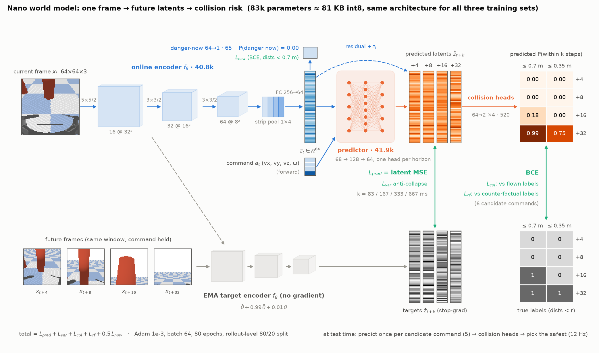
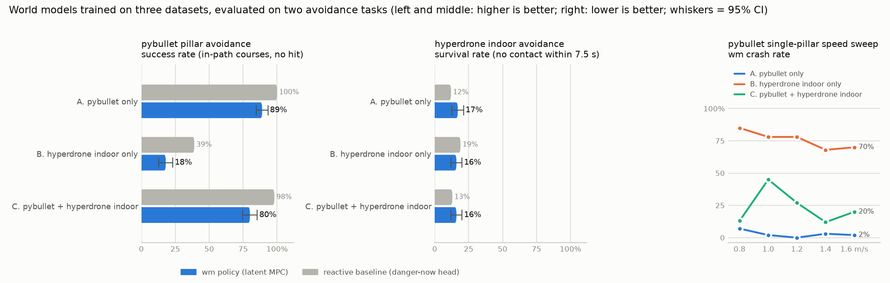
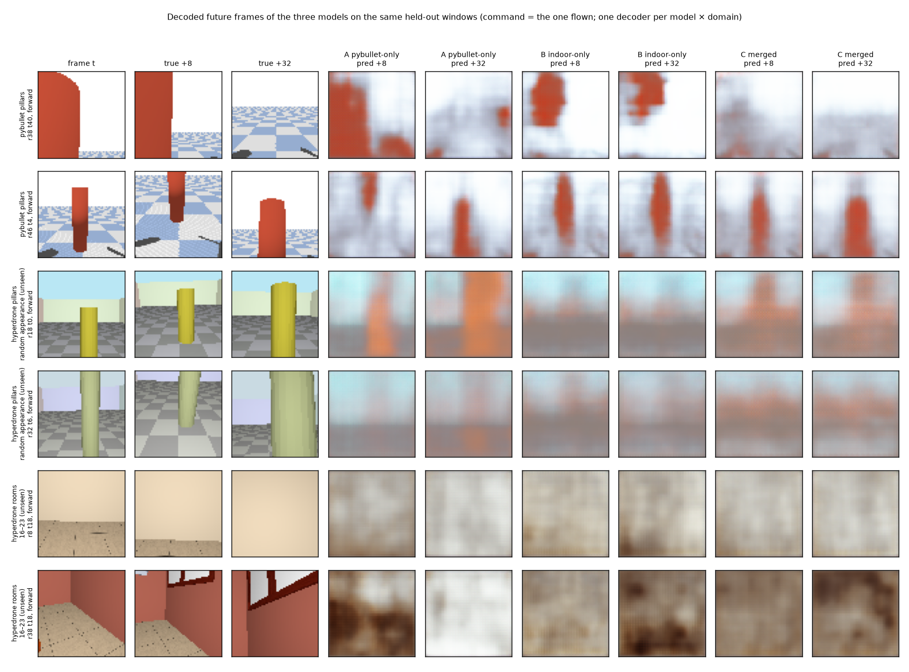

# Three training sets × two avoidance tasks: how the world model performs

[中文版 / Chinese version](REPORT.md)

The same world model (the V-JEPA-style latent model + collision heads + MPC avoidance policy of nanodrone-ai lesson 29, `train_world_model.py --epochs 80`, identical training script and hyper-parameters for all three) is trained on three datasets and then tested closed-loop on two avoidance tasks. Every script and parameter is documented in [src/README_hyperdrone_dataset.md](src/README_hyperdrone_dataset.md); the earlier exploratory experiments (each simulator's pillar look, random appearance, the large merged datasets) are archived in [src/output/report/REPORT_archive_2026-10-27.md](src/output/report/REPORT_archive_2026-10-27.md) (Chinese).

## 1. The three training sets

| training set | file | size | scenes | file size |
|---|---|---|---|---|
| A. pybullet only | `wm_dataset.npz` | 64 rollouts × 120 steps | pillars 64 / rooms 0 (0 houses) | 4 MB |
| B. hyperdrone indoor only | `wm_dataset_rooms_train60.npz` | 256 rollouts × 120 steps | pillars 0 / rooms 256 (16 houses) | 106 MB |
| C. pybullet + hyperdrone indoor | `wm_dataset_pb_plus_rooms.npz` | 320 rollouts × 120 steps | pillars 64 / rooms 256 (16 houses) | 110 MB |

- **A. pybullet only**: pillar courses from the original lesson's `gen_wm_dataset.py` (gym-pybullet-drones, CF2X + PID, 64×64, 60° body-fixed camera).
- **B. hyperdrone indoor only**: `gen_wm_dataset_hyperdrone.py --scene rooms`, 16 rollouts in each of 16 furnished ProcTHOR houses (catalog entries 0–15; hyperlux ray tracing, crazyflie + RAPTOR, the same 64×64, 60° body-fixed camera). The "danger" labels come from each house's occupancy grid / distance field at flight altitude (`wm_rooms.py`).
- **C. merged**: A and B concatenated rollout-wise (`merge_datasets.py`).

All three share the same action vocabulary (forward / slow / veer_left / veer_right / climb / hover, held segments of about 1 s), the same 4/8/16/32-step (83–667 ms) collision labels and the same counterfactual-label format.

## 2. Training (offline metrics on each dataset's held-out rollouts)

| training set | checkpoint | train / val windows | latent MSE@32 (no-op) | AUC@4/8/16/32 | now-AUC | veer ranking |
|---|---|---|---|---|---|---|
| A. pybullet only | `world_model_pybullet_ref.pth` | 2444 / 580 | 1.603 (2.835) | 0.93/0.91/0.92/0.93 | 0.84 | 1.00 (n=45) |
| B. hyperdrone indoor only | `world_model_rooms.pth` | 9664 / 2408 | 0.549 (0.601) | 0.62/0.64/0.62/0.57 | 0.72 | nan (n=0) |
| C. pybullet + hyperdrone indoor | `world_model_pb_plus_rooms.pth` | 12089 / 3007 | 0.441 (0.616) | 0.81/0.80/0.79/0.76 | 0.81 | 0.87 (n=45) |

How the model is trained, from dataset to checkpoint (`train_world_model.py`): a 64×64 frame goes through a three-layer conv encoder with bearing-aware strip pooling into a 64-d latent; an action-conditioned predictor forecasts the latent 4/8/16/32 steps ahead as residuals; collision heads read "within 0.7 m / 0.35 m within k steps" off the predicted latents, and a danger-now head reads the current latent. The prediction target is an EMA copy of the encoder (JEPA-style, no pixel loss), and the collision heads are also supervised with the dataset's counterfactual oracle for all six commands. The whole model is 83k parameters (≈ 81 KB int8). In the figure the top row is the online model, the bottom row holds the targets of the same window (EMA latents, true distance labels) and every green vertical arrow is a loss between a prediction above and its target below; the frames, latent bars and probability cells are a real held-out window and the actual forward pass of model A.



## 3. The two test tasks

**pybullet pillar avoidance** (the original lesson's scoreboard, `eval_world_model_policy.py` / `speed_sweep.py`, conda env `drone_python`): 300 random courses (210 with a pillar directly ahead, 90 safe to fly straight), 360 steps each with a 3 m finish line; the policy decides every 1/12 s from the 64×64 frame; a planar distance to a pillar axis below 0.22 m counts as a hit. A single-pillar speed sweep adds 60 courses per speed, cruising at 0.8 → 1.6 m/s.

**hyperdrone indoor avoidance** (`hd_closed_loop.py --scene rooms`, conda env `dreamer`): 300 random starts in 8 ProcTHOR houses never used in training (catalog entries 16–23; clearance ≥ 0.9 m, ≥ 2 m free ahead, random heading). The policy behaves as usual, flying forward unless it sees a threat and veering when it does, until the first contact with an obstacle (surface clearance from the distance field + 0.18 m < 0.22 m, the same test as for pillars) or until 7.5 s elapse. ProcTHOR houses contain almost no pillar-style courses (a free-standing obstacle, 3 m of straight path, room to pass on both sides), so the indoor task is a survival test.

In both tasks the reactive baseline (the same checkpoint's danger-now head + privileged veer direction) shares the encoder with the wm policy, so both change with the training set; the wm policy is the actual use of the world model.

## 4. Results



### 4.1 pybullet pillar avoidance

| training set | crash rate reactive → wm (±95% CI) | min clearance | wm triggers earlier than reactive by | false triggers on clear courses | speed sweep, wm crash rate @0.8/1.0/1.2/1.4/1.6 m/s |
|---|---|---|---|---|---|
| A. pybullet only | 0% → **11%** (±4) | 0.41 → 0.38 m | 335 ms (n=210) | 0% → 0% | 7% / 2% / 0% / 3% / 2% |
| B. hyperdrone indoor only | 61% → **82%** (±5) | 0.20 → 0.15 m | 276 ms (n=91) | 1% → 100% | 85% / 78% / 78% / 68% / 70% |
| C. pybullet + hyperdrone indoor | 2% → **20%** (±5) | 0.42 → 0.32 m | 369 ms (n=210) | 100% → 100% | 13% / 45% / 27% / 12% / 20% |

### 4.2 hyperdrone indoor avoidance (unseen houses)

| training set | survival reactive → wm (±95% CI) | time to first contact | mean flight time | mean distance flown | mean clearance | evaded at least once |
|---|---|---|---|---|---|---|
| A. pybullet only | 12% → **17%** (±4) | 4.3 → 4.7 s | 4.7 → 5.2 s | 3.56 → 3.73 m | 1.05 → 1.06 m | 43% → 84% |
| B. hyperdrone indoor only | 19% → **16%** (±4) | 4.8 → 4.9 s | 5.3 → 5.3 s | 3.90 → 3.81 m | 1.02 → 1.02 m | 81% → 88% |
| C. pybullet + hyperdrone indoor | 13% → **16%** (±4) | 4.7 → 4.7 s | 5.1 → 5.1 s | 3.75 → 3.73 m | 1.02 → 1.01 m | 73% → 88% |

**Ceiling check (`hd_oracle.py`).** The same 300 starts, flown by a privileged policy that reads the house's distance field directly (no vision, no world model) but is restricted to the wm policy's own action menu: forward, or a 0.5 s lateral veer, yaw fixed. The wm policy's selector only ever picks between the two veers, so this is the best any vision model could do inside that menu. A second variant may also hover when every moving candidate would make contact within 0.3 m.

| policy | survival (±95% CI) | mean flight time | mean distance flown | evaded at least once |
|---|---|---|---|---|
| oracle, MPC action menu (forward / 0.5 s lateral veers, fixed yaw) | **32%** (±5) | 5.9 s | 4.41 m | 99% |
| oracle + hover when boxed in | **89%** (±4) | 7.2 s | 4.34 m | 99% |

### 4.3 Supplement: offline prediction metrics (held-out frames; \* = domain used in training)

Domains: pybullet pillars; hyperdrone pillars with random appearance (seen by no model); hyperdrone rooms, houses 0–15 (the training domain of B and C); hyperdrone rooms, houses 16–23 (unseen). Metrics: collision-foresight AUC (0.5 = chance), safe-veer ranking accuracy (0.5 = chance), and the prediction gain of the latent / decoded future frame over "future = now" (0 = no predictive power).

**Collision-foresight AUC@32 (0.5 = chance)**

| training data \ domain | pybullet pillars | hyperdrone pillars, random appearance (unseen) | hyperdrone rooms, houses 0-15 | hyperdrone rooms, houses 16-23 (unseen) |
|---|---|---|---|---|
| pybullet 64 (retrained) | 0.95\* | 0.85 | 0.51 | 0.46 |
| hyperdrone rooms 256 | 0.44 | 0.57 | 0.76\* | 0.69 |
| pybullet 64 + hyperdrone rooms 256 | 0.96\* | 0.81 | 0.77\* | 0.69 |

**Collision-foresight AUC@8**

| training data \ domain | pybullet pillars | hyperdrone pillars, random appearance (unseen) | hyperdrone rooms, houses 0-15 | hyperdrone rooms, houses 16-23 (unseen) |
|---|---|---|---|---|
| pybullet 64 (retrained) | 0.95\* | 0.82 | 0.48 | 0.43 |
| hyperdrone rooms 256 | 0.45 | 0.58 | 0.71\* | 0.66 |
| pybullet 64 + hyperdrone rooms 256 | 0.96\* | 0.77 | 0.74\* | 0.68 |

**danger-now AUC**

| training data \ domain | pybullet pillars | hyperdrone pillars, random appearance (unseen) | hyperdrone rooms, houses 0-15 | hyperdrone rooms, houses 16-23 (unseen) |
|---|---|---|---|---|
| pybullet 64 (retrained) | 0.87\* | 0.54 | 0.41 | 0.41 |
| hyperdrone rooms 256 | 0.45 | 0.52 | 0.72\* | 0.69 |
| pybullet 64 + hyperdrone rooms 256 | 0.90\* | 0.67 | 0.71\* | 0.74 |

**Safe-veer ranking accuracy (0.5 = chance)**

| training data \ domain | pybullet pillars | hyperdrone pillars, random appearance (unseen) | hyperdrone rooms, houses 0-15 | hyperdrone rooms, houses 16-23 (unseen) |
|---|---|---|---|---|
| pybullet 64 (retrained) | 0.93\* | 0.89 | 0.45 | 0.21 |
| hyperdrone rooms 256 | 0.57 | 0.35 | 0.62\* | 0.18 |
| pybullet 64 + hyperdrone rooms 256 | 0.85\* | 0.50 | 0.50\* | 0.48 |

**Latent prediction gain @32 (0 = no better than "future = now")**

| training data \ domain | pybullet pillars | hyperdrone pillars, random appearance (unseen) | hyperdrone rooms, houses 0-15 | hyperdrone rooms, houses 16-23 (unseen) |
|---|---|---|---|---|
| pybullet 64 (retrained) | +0.80\* | +0.43 | -1.44 | -1.10 |
| hyperdrone rooms 256 | -0.01 | -0.06 | +0.07\* | -0.00 |
| pybullet 64 + hyperdrone rooms 256 | +0.66\* | +0.11 | -0.01\* | +0.01 |

**Decoded future-frame gain @32 (0 = no better than copying the current frame)**

| training data \ domain | pybullet pillars | hyperdrone pillars, random appearance (unseen) | hyperdrone rooms, houses 0-15 | hyperdrone rooms, houses 16-23 (unseen) |
|---|---|---|---|---|
| pybullet 64 (retrained) | +0.64\* | +0.33 | -0.58 | -0.54 |
| hyperdrone rooms 256 | +0.28 | +0.27 | +0.12\* | -0.06 |
| pybullet 64 + hyperdrone rooms 256 | +0.57\* | +0.37 | +0.10\* | +0.04 |

\* = this domain was part of the checkpoint's training data (in-sample); every other cell is data unseen during training.

### 4.4 Decoded future frames: predicted vs true

The world model predicts the next latent, never pixels. To see what each model imagines, a small decoder (64-d latent → 64×64 RGB) is fitted per model × domain on 80% of that domain's rollouts with the encoder frozen, and the predicted latent for the command actually flown is decoded at +8 and +32 steps (167 / 667 ms) on windows from the other 20%, next to the true future frames (`decode_compare.py`). All three models see the same windows. The number is the decoded-frame gain 1 − MSE(decode(ẑ₊ₖ), x₊ₖ) / MSE(xₜ, x₊ₖ): 0 means no better than copying the current frame, negative means worse (\* = domain used in training). Caveat: the predictor was trained against the EMA target encoder, whose weights are not saved, so decoded predictions carry that mismatch on top of what a 64-d latent can hold. Expect blurry shapes in the right place, not photographs.

| training set \ domain (gain @8 / @32) | pybullet pillars | hyperdrone pillars, random appearance (unseen) | hyperdrone rooms 16–23 (unseen) |
|---|---|---|---|
| A. pybullet only | +0.44 / +0.64\* | +0.07 / +0.33 | -0.35 / -0.55 |
| B. hyperdrone indoor only | +0.21 / +0.29 | +0.13 / +0.27 | -0.23 / -0.06 |
| C. pybullet + hyperdrone indoor | +0.26 / +0.57\* | +0.06 / +0.36 | -0.10 / +0.09 |



## 5. Process videos

pybullet pillar forest, 4 rows (`forest_demo.py --rows 4`; left: top-down trajectory, right: onboard view):

**A. pybullet only** — [mp4](src/output/report/forest_pb_ref_wm-mpc.mp4)


**B. hyperdrone indoor only** — [mp4](src/output/report/forest_pb_rooms_wm-mpc.mp4)


**C. merged** — [mp4](src/output/report/forest_pb_pb_plus_rooms_wm-mpc.mp4)


hyperdrone indoor (house 17, seed 1017, the same start for all three; left: occupancy map + trajectory, right: the 64×64 frame the policy sees):

**A. pybullet only** — [mp4](src/output/report/hd_room17_pybullet_ref.mp4)


**B. hyperdrone indoor only** — [mp4](src/output/report/hd_room17_rooms.mp4)


**C. merged** — [mp4](src/output/report/hd_room17_pb_plus_rooms.mp4)


## 6. Conclusions

1. **pybullet pillar avoidance: the pybullet-only model is best, adding indoor data makes it worse, and the indoor-only model does not transfer at all.** On 300 courses the wm policy crashes on 11% (A), 20% (C) and 82% (B). B has never seen a pillar or a pybullet frame, so its collision heads are near chance there (offline AUC 0.44). C is 9 points worse than A (CI ±4, so the gap is real): merging 256 out-of-domain indoor rollouts into 64 pybullet rollouts dilutes the pybullet distribution and shifts the collision-head calibration, while the MPC trigger margin is still the one tuned for the pybullet model.
2. **hyperdrone indoor avoidance: the three models tie (16–17% survival, CI ±4); indoor data brings no indoor advantage.** The offline metrics nevertheless show that B and C foresee indoor danger better than A: in the unseen houses 16–23 their collision-foresight AUC is 0.69 against 0.46 for A (chance level), and their danger-now AUC 0.69–0.74 against 0.41. Foreseeing danger without surviving means the indoor task is currently limited by the **policy**, not by the world model: this MPC only has "0.5 s left/right pulses + a centering prior", whereas rooms demand sustained navigation along walls, through doors and around furniture, so even a correct prediction leaves no suitable action to pick. The ceiling check in 4.2 confirms it: a privileged policy that reads the room geometry directly but is restricted to the same action menu survives only 32%, and reaches 89% once it may hover when boxed in. The vision models' 16–17% is already half of what this action space allows; A gets there with the generic reaction "a large nearby object ahead triggers an evasion".
3. **Indoor data alone teaches the world model almost no prediction.** B's latent prediction error is 0.549 against 0.601 for the no-op baseline (under 10% improvement), its held-out AUC@32 is only 0.57, and its decoded future frames in unseen houses are no better than copying the current frame. Adding the 64 pybullet pillar rollouts (C) raises AUC@32 to 0.76 and veer ranking to 0.87. The pillar data gives the latent space the simple skeleton "an obstacle is an object that grows in front of you"; the room data alone cannot carry the 64-d latent + latent-MSE objective. The decoded frames in 4.4 show this directly: for the same pillar straight ahead, A draws it clearly larger at +32, B draws almost the same pillar at +8 and +32 ("future = now"), and C sits in between; in unseen rooms all three produce only wall and floor colour fields, never furniture.
4. **Robustness to unseen appearance comes from the pybullet data, not from the indoor data.** Collision-foresight AUC on randomly textured pillars: A 0.85, C 0.81, B 0.57.
5. **Implications for the real drone.** (a) The current indoor data cannot produce a policy that flies indoors. The first thing to fix is the MPC's action space and goal layer (allow hover, sustained turning, wall following, a goal point), then data volume (256 rollouts and 16 houses are far too few) and the latent objective (higher dimension, contrastive, or auxiliary pixel/depth supervision). (b) Among the existing models, A or C (both contain pybullet data) are the ones worth trying on the real drone, with appearance randomization switched on when generating hyperdrone data. (c) Evaluate primarily with collision-foresight AUC and veer ranking on unseen domains; read closed-loop survival together with policy changes; re-test with shadow inference on the real drone before deployment.
6. Note: A is `world_model_pybullet_ref.pth`, retrained with the same script, not the repository's shipped `world_model.pth`, so that all three share identical training conditions; the shipped weights are more robust (see the archived report).

## 7. Reproduce

```bash
# data (conda env dreamer)
python src/gen_wm_dataset_hyperdrone.py --scene rooms --rollouts 256 --rooms 256 --houses 16 --house-first 0 --len 120 --fov-deg 60 --camera body --out src/output/wm_dataset_rooms_train60.npz
python src/merge_datasets.py src/output/wm_dataset.npz src/output/wm_dataset_rooms_train60.npz --out src/output/wm_dataset_pb_plus_rooms.npz
# training (GPU)
python src/train_world_model.py --epochs 80 --data src/output/wm_dataset_rooms_train60.npz --out src/output/world_model_rooms.pth
# pybullet task (conda env drone_python)
python src/eval_world_model_policy.py --seeds 300 --model src/output/world_model_rooms.pth
python src/speed_sweep.py --seeds 60 --no-learned --model src/output/world_model_rooms.pth --plot src/output/speed_sweep_rooms.png
# hyperdrone indoor task and its oracle ceiling (conda env dreamer)
python src/hd_closed_loop.py --scene rooms --houses 8 --house-first 16 --seeds 300 --sweep-seeds 0 --model src/output/world_model_rooms.pth
python src/hd_oracle.py --houses 8 --house-first 16 --seeds 300 | tee src/output/evals/oracle_rooms.log
# offline prediction metrics, videos, this report
python src/eval_offline.py --models pybullet_ref rooms pb_plus_rooms --domains pybullet rand_pillars rooms_train rooms_unseen --out three_way
python src/hd_video.py --scene rooms --house 17 --seed 1017 --model src/output/world_model_rooms.pth --tag room17_rooms
python src/decode_compare.py --lang both
python src/draw_pipeline.py --lang both
python src/make_report_three.py --lang en
```
