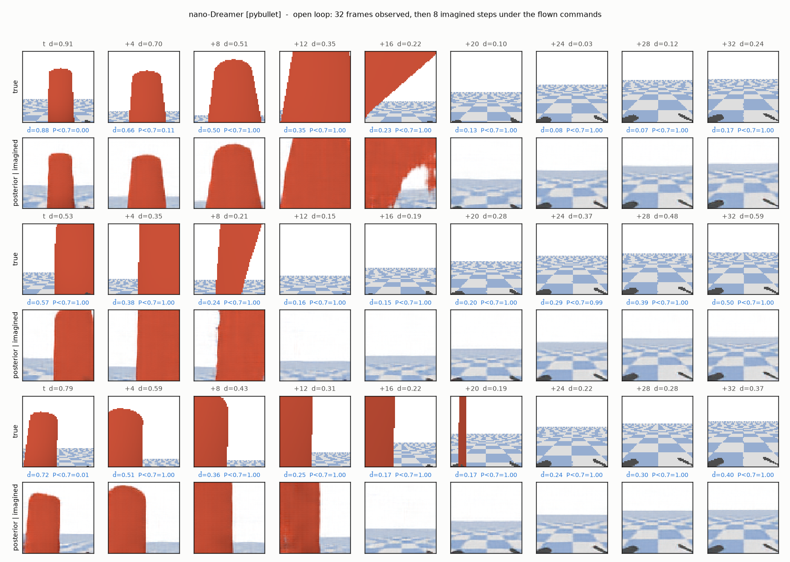
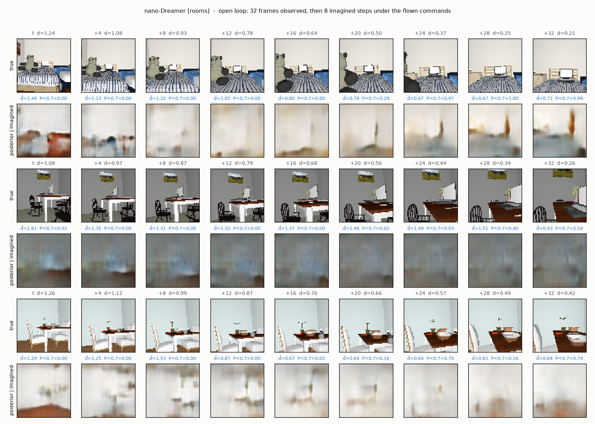
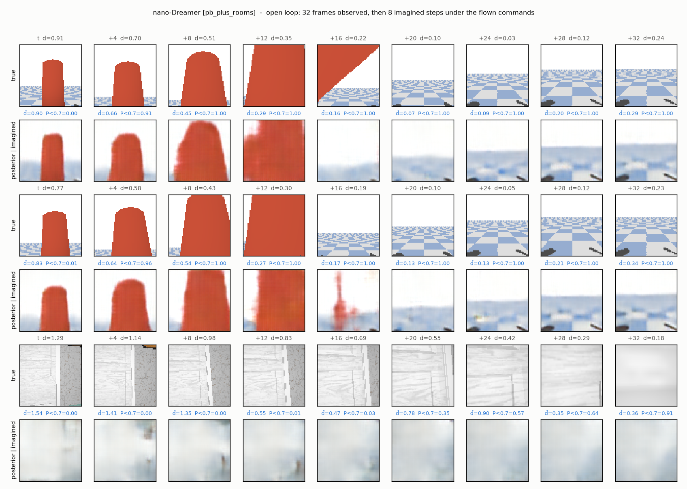

# nano-Dreamer（RSSM 世界模型）首轮训练结果

分支 `dreamerv3-world-model`，方案见 [PLAN_dreamerv3.md](../../../PLAN_dreamerv3.md)。同一套三个训练集（A/B/C）、同一套测试，只把世界模型从单帧 JEPA 预测器换成 DreamerV3 风格的 RSSM（`train_dreamer.py`，1.26M 参数，12 Hz 建模，2 万步，三个模型同一超参）。闭环策略 `DreamerMPCPolicy` 的触发和代价与 `WMPolicy` 完全相同，只是候选命令的后果由想象 8 步得到，且信念状态跨决策保留。

## 1. 训练集内 held-out 指标

旧模型的 AUC 是单帧 posterior 直接读碰撞头；Dreamer 的 AUC 是 **open-loop**：观测 667 ms 后在飞过的命令下纯想象 8 步（= +32 帧）再读头，设定更难。解码增益 = 1 − MSE(预测帧, 真帧)/MSE(当前帧, 真帧)。

| 训练集 | 模型 | AUC@32 | 解码增益 @8 / @32 | 想象 @32 的净空 MAE | veer ranking |
|---|---|---|---|---|---|
| A 纯 pybullet（64 rollouts） | JEPA 单帧（83k） | 0.93 | （事后拟合解码器，见报告 4.4） | — | 1.00 (n=45) |
| A 纯 pybullet（64 rollouts） | nano-Dreamer（1.26M，20k 步） | **0.96** | +0.29 / +0.53 | 0.27 m | 0.95 (n=19) |
| A 纯 pybullet（64 rollouts） | nano-Dreamer，反事实损失不做视野 mask（8k 步） | **0.99** | +0.33 / +0.56 | 0.27 m | 0.89 (n=19) |
| B 纯 hyperdrone 室内（256 rollouts） | JEPA 单帧（83k） | 0.57 | （事后拟合解码器，见报告 4.4） | — | nan (n=0) |
| B 纯 hyperdrone 室内（256 rollouts） | nano-Dreamer（1.26M，20k 步） | **0.76** | +0.03 / +0.05 | 0.46 m | 0.45 (n=76) |
| B 纯 hyperdrone 室内（256 rollouts） | nano-Dreamer，6k 步早停 | **0.81** | +0.16 / +0.18 | 0.41 m | 0.46 (n=76) |
| C 合并（320 rollouts） | JEPA 单帧（83k） | 0.76 | （事后拟合解码器，见报告 4.4） | — | 0.87 (n=45) |
| C 合并（320 rollouts） | nano-Dreamer（1.26M，20k 步） | **0.84** | +0.11 / +0.18 | 0.38 m | 0.78 (n=78) |
| C 合并（320 rollouts） | nano-Dreamer，6k 步早停 | **0.83** | +0.18 / +0.14 | 0.40 m | 0.82 (n=78) |

训练过程中每 4k 步的 held-out 评估（AUC@32 / 增益@32）：
- A: 4k: 0.99/+0.55，8k: 0.98/+0.54，12k: 0.99/+0.54，16k: 0.98/+0.54
- B: 4k: 0.81/+0.17，8k: 0.81/+0.11，12k: 0.79/+0.10，16k: 0.74/+0.06
- C: 4k: 0.84/+0.20，8k: 0.84/+0.20，12k: 0.85/+0.20，16k: 0.84/+0.14

## 2. 离线泛化网格（held-out 帧，\* = 训练时见过的数据域）

**碰撞预判 AUC@32（0.5 = 随机）**

| 训练集 | 模型 | pybullet 柱子 | hyperdrone 柱子·随机外观（未见） | 室内房 0–15 | 室内房 16–23（未见） |
|---|---|---|---|---|---|
| A | JEPA 单帧 | 0.95\* | 0.85 | 0.51 | 0.46 |
| A | nano-Dreamer | 1.00\* | 0.73 | 0.64 | 0.75 |
| A | nano-Dreamer，反事实损失不做视野 mask（8k 步） | 1.00\* | 0.81 | 0.68 | 0.72 |
| B | JEPA 单帧 | 0.44 | 0.57 | 0.76\* | 0.69 |
| B | nano-Dreamer | 0.59 | 0.76 | 0.84\* | 0.90 |
| B | nano-Dreamer，6k 步早停 | 0.64 | 0.83 | 0.91\* | 0.89 |
| C | JEPA 单帧 | 0.96\* | 0.81 | 0.77\* | 0.69 |
| C | nano-Dreamer | 1.00\* | 0.71 | 0.85\* | 0.85 |
| C | nano-Dreamer，6k 步早停 | 0.99\* | 0.83 | 0.83\* | 0.85 |

**解码未来帧增益 @32（0 = 不比复制当前帧好）**

| 训练集 | 模型 | pybullet 柱子 | hyperdrone 柱子·随机外观（未见） | 室内房 0–15 | 室内房 16–23（未见） |
|---|---|---|---|---|---|
| A | JEPA 单帧 | +0.64\* | +0.33 | -0.58 | -0.54 |
| A | nano-Dreamer | +0.91\* | -0.74 | -2.64 | -1.44 |
| A | nano-Dreamer，反事实损失不做视野 mask（8k 步） | +0.91\* | -0.71 | -2.79 | -1.47 |
| B | JEPA 单帧 | +0.28 | +0.27 | +0.12\* | -0.06 |
| B | nano-Dreamer | -2.55 | -0.24 | +0.16\* | +0.10 |
| B | nano-Dreamer，6k 步早停 | -4.05 | -0.52 | +0.20\* | -0.07 |
| C | JEPA 单帧 | +0.57\* | +0.37 | +0.10\* | +0.04 |
| C | nano-Dreamer | +0.85\* | -0.13 | +0.07\* | +0.25 |
| C | nano-Dreamer，6k 步早停 | +0.74\* | -0.01 | +0.20\* | +0.15 |

**安全绕行方向排序准确率（0.5 = 随机）**

| 训练集 | 模型 | pybullet 柱子 | hyperdrone 柱子·随机外观（未见） | 室内房 0–15 | 室内房 16–23（未见） |
|---|---|---|---|---|---|
| A | JEPA 单帧 | 0.93\* | 0.89 | 0.45 | 0.21 |
| A | nano-Dreamer | 0.92\* | 0.47 | 0.20 | 0.52 |
| A | nano-Dreamer，反事实损失不做视野 mask（8k 步） | 0.92\* | 0.59 | 0.64 | 0.36 |
| B | JEPA 单帧 | 0.57 | 0.35 | 0.62\* | 0.18 |
| B | nano-Dreamer | 0.37 | 0.58 | 0.43\* | 0.79 |
| B | nano-Dreamer，6k 步早停 | 0.51 | 0.63 | 0.38\* | 0.24 |
| C | JEPA 单帧 | 0.85\* | 0.50 | 0.50\* | 0.48 |
| C | nano-Dreamer | 0.80\* | 0.67 | 0.18\* | 0.67 |
| C | nano-Dreamer，6k 步早停 | 0.73\* | 0.74 | 0.43\* | 0.30 |

## 3. 闭环测试

pybullet 柱子避障：300 条随机 course（210 条有柱子），记 wm 策略的穿越率；室内续航：ProcTHOR 房 16–23 共 300 个起点，1.0 m/s 飞 7.5 s，记无接触的生存率。reactive 基线用同一模型的 danger-now（Dreamer：posterior 上的 0.7 m 头）加特权方向。

| 训练集 | 模型 | pybullet 穿越率 reactive → wm | 最小净空 | 误触发（无柱 course） | 室内生存率 reactive → wm | 室内平均飞行时间 | 室内生存率，菜单含 hover |
|---|---|---|---|---|---|---|---|
| A | JEPA 单帧 | 0% → **11%** | 0.41 → 0.38 m | 0% → 0% | 12% → **17%** | 4.7 → 5.2 s | **23%**（飞行 5.3 s，3.60 m） |
| A | nano-Dreamer，首版读数（单次采样想象，含当前状态） | 4% → **41%** | 0.39 → 0.30 m | 0% → 1% | 21% → **17%** | 5.2 → 5.1 s | **17%**（飞行 5.1 s，3.61 m） |
| A | nano-Dreamer（8 条想象平均，只看未来） | 4% → **34%** | 0.39 → 0.32 m | 0% → 0% | 23% → **17%** | 5.2 → 5.1 s | **17%**（飞行 5.1 s，3.66 m） |
| A | nano-Dreamer，反事实损失不做视野 mask（8k 步） | 13% → **34%** | 0.36 → 0.33 m | 0% → 0% | 未跑 | — | 未跑 |
| B | JEPA 单帧 | 61% → **82%** | 0.20 → 0.15 m | 1% → 100% | 19% → **16%** | 5.3 → 5.3 s | **19%**（飞行 5.4 s，3.76 m） |
| B | nano-Dreamer，首版读数（单次采样想象，含当前状态） | 62% → **85%** | 0.23 → 0.14 m | 100% → 100% | 18% → **15%** | 5.1 → 5.1 s | **17%**（飞行 5.1 s，3.70 m） |
| B | nano-Dreamer（8 条想象平均，只看未来） | 62% → **82%** | 0.23 → 0.14 m | 100% → 100% | 17% → **17%** | 5.0 → 5.0 s | **16%**（飞行 5.0 s，3.66 m） |
| B | nano-Dreamer，6k 步早停 | 未跑 | — | — | 14% → **12%** | 4.9 → 4.9 s | **14%**（飞行 4.9 s，3.61 m） |
| C | JEPA 单帧 | 2% → **20%** | 0.42 → 0.32 m | 100% → 100% | 13% → **16%** | 5.1 → 5.1 s | **19%**（飞行 5.2 s，3.70 m） |
| C | nano-Dreamer，首版读数（单次采样想象，含当前状态） | 3% → **20%** | 0.44 → 0.44 m | 0% → 0% | 19% → **16%** | 5.2 → 5.1 s | **16%**（飞行 5.1 s，3.67 m） |
| C | nano-Dreamer（8 条想象平均，只看未来） | 3% → **20%** | 0.44 → 0.42 m | 0% → 0% | 16% → **15%** | 5.1 → 5.1 s | **16%**（飞行 5.1 s，3.72 m） |
| C | nano-Dreamer，6k 步早停 | 5% → **27%** | 0.43 → 0.32 m | 0% → 0% | 23% → **19%** | 5.3 → 5.2 s | **18%**（飞行 5.2 s，3.71 m） |

参考：同菜单的特权 oracle 室内生存率 32%，允许悬停 89%（报告 4.2 节）。「菜单含 hover」= `--allow-stop`：两个绕行方向在 ~170 ms 内的 P(< 0.35 m) 都超过 0.5 时悬停 0.5 s（对应 oracle 的 +hover 规则），新旧模型同一规则。

## 4. open-loop 想象的解码帧（held-out 窗口）

上排真帧，下排：第 1 列是 posterior 重建，其后 8 列是观测 32 帧后在飞过的命令下想象 +4…+32 帧的解码结果；蓝字是想象状态读出的净空距离和 P(< 0.7 m)。

**A 纯 pybullet（64 rollouts）**



**B 纯 hyperdrone 室内（256 rollouts）**



**C 合并（320 rollouts）**



## 5. 复现

```bash
python src/train_dreamer.py --data src/output/wm_dataset.npz --out src/output/world_model_dreamer_pybullet.pth --tag pybullet --steps 20000
python src/train_dreamer.py --data src/output/wm_dataset_rooms_train60.npz --out src/output/world_model_dreamer_rooms.pth --tag rooms --steps 20000
python src/train_dreamer.py --data src/output/wm_dataset_pb_plus_rooms.npz --out src/output/world_model_dreamer_pb_plus_rooms.pth --tag pb_plus_rooms --steps 20000
python src/eval_offline.py --models dreamer_pybullet dreamer_rooms dreamer_pb_plus_rooms --domains pybullet rand_pillars rooms_train rooms_unseen --out dreamer_three
python src/eval_world_model_policy.py --seeds 300 --model src/output/world_model_dreamer_pybullet.pth   # conda env drone_python, per model
python src/hd_closed_loop.py --scene rooms --houses 8 --house-first 16 --seeds 300 --sweep-seeds 0 --model src/output/world_model_dreamer_pybullet.pth
python src/dreamer_summary.py
```
